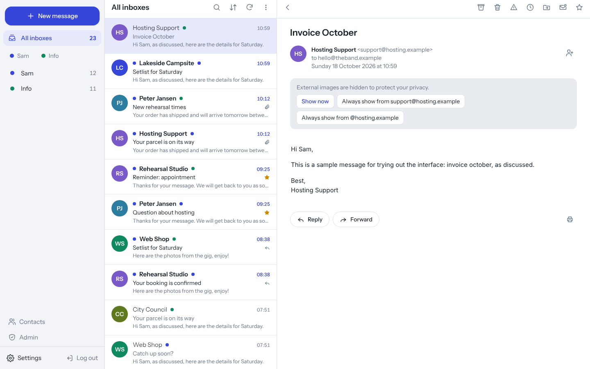
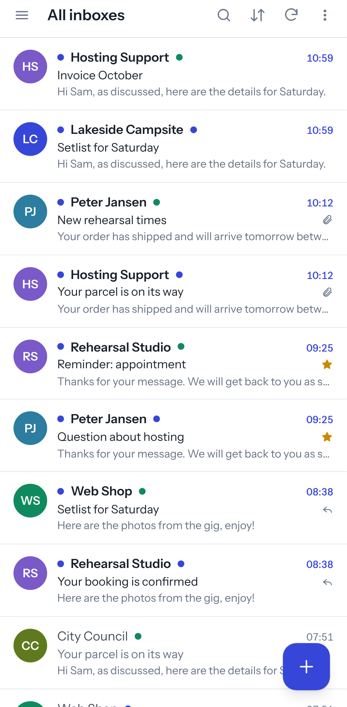
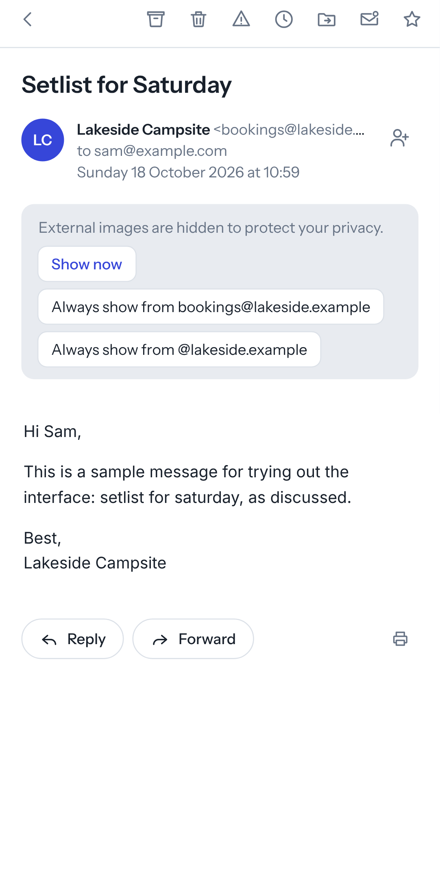
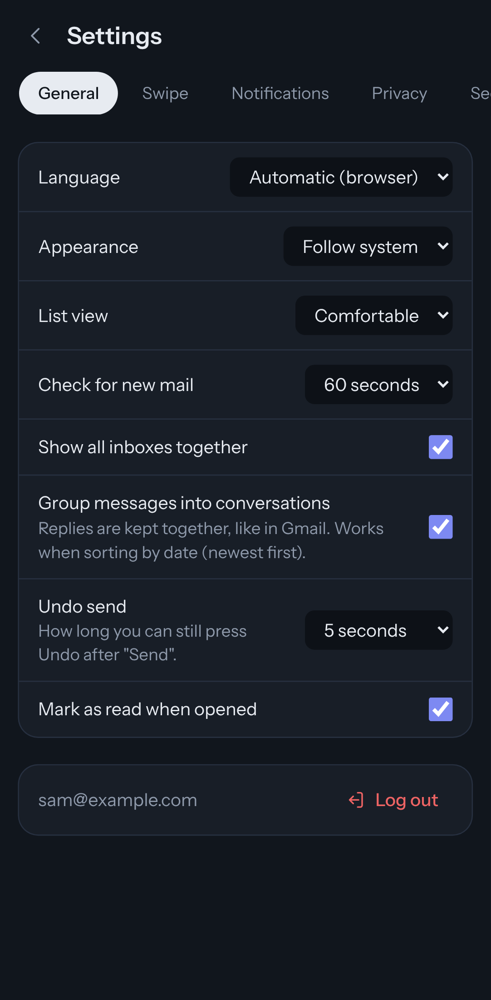

# Postvak

A modern, mobile-friendly webmail client for your own IMAP mailboxes. Built to run on ordinary
shared hosting: PHP + MySQL on the server, a Vue single-page app in the browser, installable as an app
on your phone (PWA). No Node.js, no daemons, no SSH needed on the server.

*Postvak* is Dutch for "mailbox".

<p align="center">
  
</p>
<p align="center">
  
  
  
</p>

## Features

**Reading and organising**
- Swipe to archive, delete, snooze or mark as spam on phone and tablet, with undo. Each user picks what left and right swipes do.
- Conversation view (IMAP THREAD), including your own replies from Sent.
- One inbox for all your accounts, or each account separately.
- Multi-select, move to folder, drag & drop onto folders, create/rename/delete folders.
- Search (subject and sender, optionally the message text), mark all as read, empty trash and spam.
- Snooze: a message disappears and comes back to the inbox at the time you choose.
- Attachment viewer for images and PDF, print view.

**Writing**
- Rich text editor (headings, lists, links, colours, clean paste from Word), the quoted original kept intact.
- Drafts saved automatically, send later, undo send, address autocomplete from a contacts list.
- Send from any of your accounts, each with its own signature.

**Everything else**
- Push notifications for new mail on phone and desktop (Web Push, no third-party service).
- Contacts page with vCard import and export.
- Optional two-step verification (TOTP) with recovery codes and remembered devices.
- Privacy by default: remote images blocked until you allow them (per message, sender or domain), mail HTML
  sanitised on the server and again in the browser, shown in a sandboxed frame.
- Light and dark theme, keyboard shortcuts (press `?`), Dutch and English interface.
- Admin page: users, login attempts and blocks, allowed domains, default settings, background job status.

## How it works

```
Browser (Vue PWA)  ⇄  PHP JSON API  ⇄  IMAP / SMTP server of your host
                          ⇅
                        MySQL (users, accounts, settings, contacts)
                          ⇅
               cron.php every 5 minutes (notifications, send later, snooze)
```

Postvak has no passwords of its own: you log in with a mailbox address and password, which the API
checks against the IMAP server. Mailbox passwords are stored encrypted (libsodium) so that multiple
accounts work without logging in to each one. Mail stays on the mail server. See [SECURITY.md](SECURITY.md)
and [docs/ARCHITECTURE.md](docs/ARCHITECTURE.md).

## Requirements

- PHP 8.2+ with `mbstring`, `openssl`, `sodium`, `pdo_mysql`, `iconv`, `dom` (the old `imap` extension is **not** needed)
- MySQL 5.7+ or MariaDB 10.3+
- Apache or LiteSpeed with `mod_rewrite` (for `.htaccess`), HTTPS
- An IMAP + SMTP mail server (the one from your hosting is fine)
- Optional: a cron job every 5 minutes, for notifications, send later and snooze

## Installing

1. Download `postvak-x.y.z.zip` from the [latest release](../../releases/latest) and unpack it.
2. Create an empty MySQL database in your hosting control panel.
3. Upload the contents of `public/` to the web root of your (sub)domain, and the `app/` folder **next to**
   the web root (not inside it).
4. Open `https://your-domain/install.php` and fill in the form. The installer checks the server,
   creates the tables, writes `app/config/config.php` and deletes itself.
5. Log in with a mailbox address and password. Set up the cron job for `app/cron.php`.

Step-by-step guides: [INSTALL.md](docs/INSTALL.md) (English) · [INSTALL.nl.md](docs/INSTALL.nl.md) (Nederlands).
Updating: upload the new `public/` and `app/` over the old ones (keep `app/config/config.php`); database
changes are applied automatically at the next login.

## Development

```bash
# Frontend only, with fake data. No PHP or mail server needed:
npm --prefix frontend install
npm run dev:mock            # http://localhost:5173 (any address and password log in)

# Full stack against a real mailbox:
cd backend && composer install && cp config/config.example.php config/config.php   # fill it in
cd .. && npm run dev:api    # PHP API on :8000
npm run dev                 # Vite on :5173, proxies /api to :8000
```

Tests:

```bash
php backend/tests/run.php            # API unit tests (no PHPUnit needed)
npm --prefix frontend test           # Vitest
npm --prefix frontend run test:e2e   # Playwright, against the demo mode
node scripts/check-i18n.mjs          # every text exists in every language
```

Deploying your own build over FTP: `npm run deploy` (see [docs/INSTALL.nl.md](docs/INSTALL.nl.md)).
Building the release zip: `node scripts/release.mjs` (the GitHub workflow does this for every `v*` tag).

## Project layout

```
backend/              PHP API (PSR-4, namespace Postvak\)
  public/             web root: .htaccess, api/index.php (+ the built frontend)
  src/                Controllers, Mail (IMAP/SMTP/sanitising), Push, Cron, Security, Repositories
  database/           schema.sql and migrations
  installer/          install.php for the release zip
  tests/              unit tests
  cron.php            background jobs
frontend/             Vue 3 + Vite + Tailwind CSS 4
  src/api/            API client and mock backend
  src/stores/         Pinia stores
  src/i18n/           nl.js (reference) and en.js
  e2e/                Playwright tests
scripts/              deploy (FTP), release zip, screenshots, translation check
docs/                 architecture, roadmap, installation guides
```

## Contributing

Issues and pull requests are welcome. Please read [CONTRIBUTING.md](CONTRIBUTING.md) first.
A new interface language is one file in `frontend/src/i18n` plus the texts in `frontend/public/push-sw.js`.

## License

[MIT](LICENSE)
