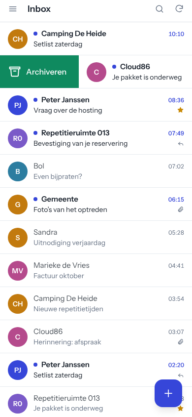
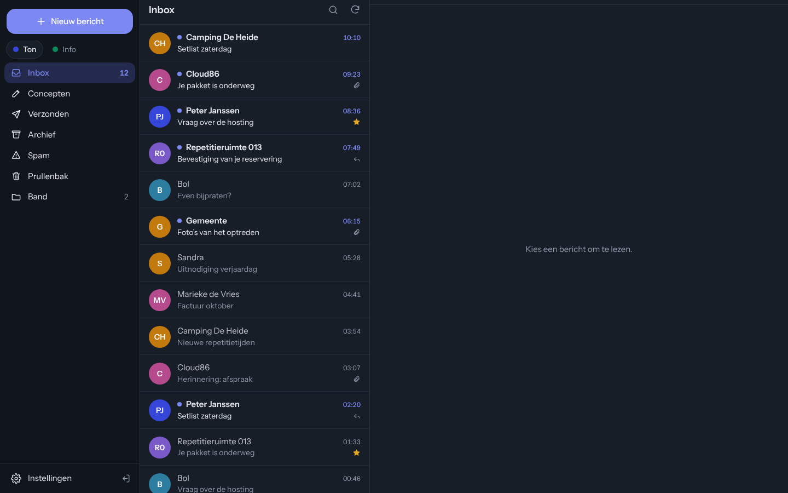

# Postvak

A modern, mobile-friendly webmail client for your own IMAP mailboxes. Built to run on ordinary
shared hosting: PHP + MySQL on the server, a Vue single-page app in the browser, installable as an app
on your phone (PWA). No Node.js, no daemons, no SSH needed on the server.

<p align="center">
  
  
</p>

## Features

- **Swipe to archive or delete** on phone and tablet, with undo. Each user picks what left and right
  swipes do (archive, delete, read/unread, star, nothing).
- **Multiple accounts per user.** Log in with any of your mailboxes, add others, and send from each of them.
- **Responsive layout:** three columns on desktop, two on tablet, one on phone.
- **Privacy by default:** remote images are blocked until you allow them, mail HTML is sanitised on the
  server and again in the browser, and shown in a sandboxed frame.
- Light and dark theme, keyboard shortcuts (`j`/`k`, `e`, `#`, `c`, `Esc`), address autocomplete,
  attachments, reply / reply all / forward.
- Dutch interface; translations are a single file (`frontend/src/i18n`).

See [docs/ROADMAP.md](docs/ROADMAP.md) for what is planned next.

## How it works

```
Browser (Vue PWA)  ⇄  PHP JSON API  ⇄  IMAP / SMTP server of your host
                          ⇅
                        MySQL (users, accounts, settings, contacts)
```

Postvak never stores its own passwords: you log in with a mailbox address and password, which the API
checks against the IMAP server. Mailbox passwords are stored encrypted (libsodium) so that multiple
accounts work without logging in to each one. See [SECURITY.md](SECURITY.md) and
[docs/ARCHITECTURE.md](docs/ARCHITECTURE.md).

## Requirements

- PHP 8.2+ with `mbstring`, `openssl`, `sodium`, `pdo_mysql`, `iconv`, `fileinfo`, `zip`, `libxml`
  (the old `imap` extension is **not** needed)
- MySQL 5.7+ or MariaDB 10.3+
- Apache or LiteSpeed with `mod_rewrite` (for `.htaccess`)
- For building: Node.js 20+ and Composer on your own computer

## Quick start (development)

```bash
# Frontend only, with fake data. No PHP or mail server needed:
npm --prefix frontend install
npm run dev:mock            # http://localhost:5173

# Full stack against a real mailbox:
cd backend && composer install && cp config/config.example.php config/config.php   # fill it in
cd .. && npm run dev:api    # PHP API on :8000
npm run dev                 # Vite on :5173, proxies /api to :8000
```

## Installing on shared hosting

Step-by-step instructions (in Dutch) for a DirectAdmin/cPanel host with FTP only:
[docs/INSTALL.nl.md](docs/INSTALL.nl.md). In short:

1. Create a MySQL database and import `backend/database/schema.sql`.
2. `composer install --no-dev` in `backend`, copy and fill in `config/config.php`.
3. Copy `.env.deploy.example` to `.env.deploy` and fill in the FTP details.
4. `npm run deploy -- --with-config` for the first install, `npm run deploy` after that.

## Project layout

```
backend/            PHP API (PSR-4, namespace Postvak\)
  public/           web root: .htaccess, api/index.php (+ the built frontend)
  src/              Controllers, Mail (IMAP/SMTP/sanitising), Repositories, Http
  database/         schema.sql and migrations
  config/           config.example.php
frontend/           Vue 3 + Vite + Tailwind CSS 4
  src/api/          API client and mock backend
  src/stores/       Pinia stores (session, mail, toasts)
  src/components/   Message list, swipe rows, reader, composer, …
scripts/deploy.mjs  FTP(S) deploy
docs/               Architecture, roadmap, installation guide
```

## Contributing

Issues and pull requests are welcome. Please read [CONTRIBUTING.md](CONTRIBUTING.md) first.

## License

[MIT](LICENSE)
