# Handleiding Postvak

Postvak is webmail voor je eigen hostingserver: mail, agenda, taken en contacten op één plek, op je computer,
tablet en telefoon. Deze handleiding is voor iedereen die Postvak gebruikt. Ben je beheerder en wil je Postvak
installeren? Kijk dan in de [installatiehandleiding](INSTALL.nl.md).

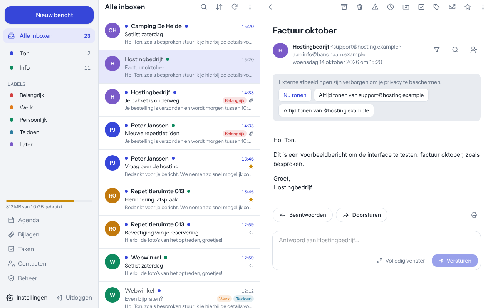

## Inhoud

1. [Inloggen](#1-inloggen)
2. [Postvak als app op je telefoon, tablet of computer](#2-postvak-als-app-op-je-telefoon-tablet-of-computer)
3. [Het scherm](#3-het-scherm)
4. [Mail lezen](#4-mail-lezen)
5. [Mail opruimen: archiveren, verwijderen, verplaatsen, snoozen](#5-mail-opruimen)
6. [Zoeken en filteren](#6-zoeken-en-filteren)
7. [Labels](#7-labels)
8. [Mail schrijven](#8-mail-schrijven)
9. [Grote bestanden versturen](#9-grote-bestanden-versturen)
10. [Meerdere mailadressen](#10-meerdere-mailadressen)
11. [Regels en afwezigheidsmelding](#11-regels-en-afwezigheidsmelding)
12. [Agenda](#12-agenda)
13. [Taken](#13-taken)
14. [Contacten](#14-contacten)
15. [Agenda, taken en contacten op je telefoon](#15-agenda-taken-en-contacten-op-je-telefoon)
16. [Meldingen bij nieuwe mail](#16-meldingen-bij-nieuwe-mail)
17. [Instellingen](#17-instellingen)
18. [Sneltoetsen](#18-sneltoetsen)
19. [Privacy en veiligheid](#19-privacy-en-veiligheid)
20. [Voor de beheerder](#20-voor-de-beheerder)
21. [Vragen en problemen](#21-vragen-en-problemen)

---

## 1. Inloggen

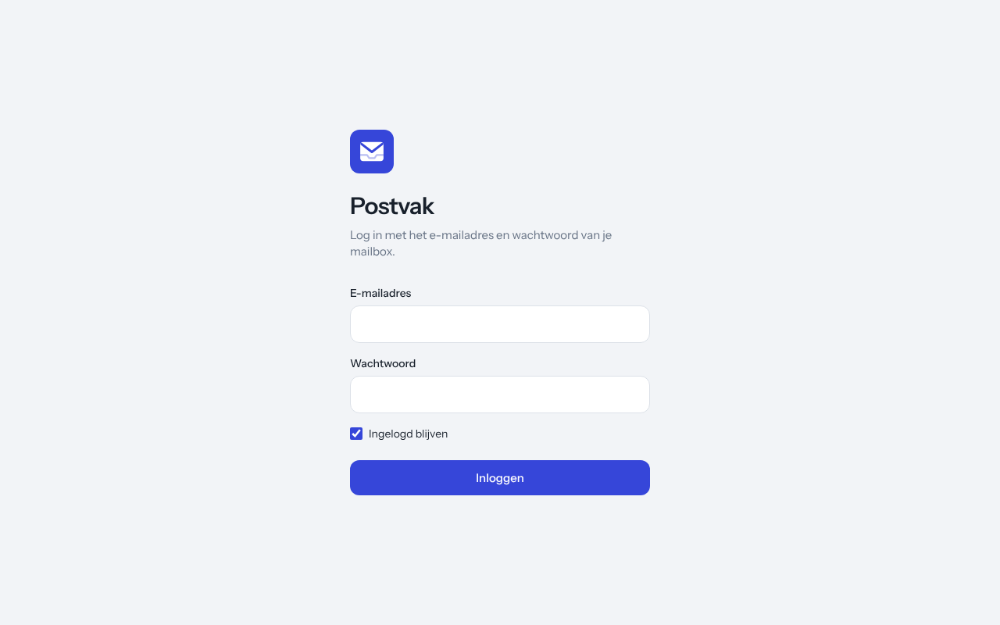

Je logt in met je **mailadres en het wachtwoord van je mailbox**. Postvak heeft geen eigen wachtwoorden: het
controleert je gegevens bij de mailserver.

- **Ingelogd blijven**: vink dit aan op je eigen apparaat. Je blijft dan 30 dagen ingelogd. Op een gedeelde of
  openbare computer laat je het uit.
- **Tweestapsverificatie**: heb je die aangezet (zie [Beveiliging](#17-instellingen)), dan vraagt Postvak na je
  wachtwoord om de code uit je authenticator-app. Telefoon kwijt? Gebruik een van je herstelcodes.
- Na een paar mislukte pogingen wordt inloggen tijdelijk geblokkeerd. Even wachten en opnieuw proberen.

## 2. Postvak als app op je telefoon, tablet of computer

Postvak werkt in elke browser, maar je kunt het ook als app installeren. Het krijgt dan een eigen pictogram,
opent zonder adresbalk en kan meldingen geven.

| Apparaat | Zo installeer je het |
| --- | --- |
| **iPhone / iPad** | Open Postvak in **Safari** → tik op **Deel** (vierkantje met pijl) → **Zet op beginscherm**. |
| **Android** | Open Postvak in **Chrome** → menu **⋮** → **App installeren** (of **Toevoegen aan startscherm**). |
| **Computer** | In Chrome of Edge: klik op het installatie-icoon rechts in de adresbalk, of menu → **Postvak installeren**. |

**Updates** gaan vanzelf. Postvak kijkt bij het openen, als je terugkomt in de app en elke 30 minuten of er een
nieuwe versie is. Ben je niet aan het schrijven, dan laadt de nieuwe versie meteen; anders verschijnt onderin een
balk met **Bijwerken**. Welke versie je hebt zie je onder **Instellingen → Algemeen**, met de knop
**Op updates controleren**.

  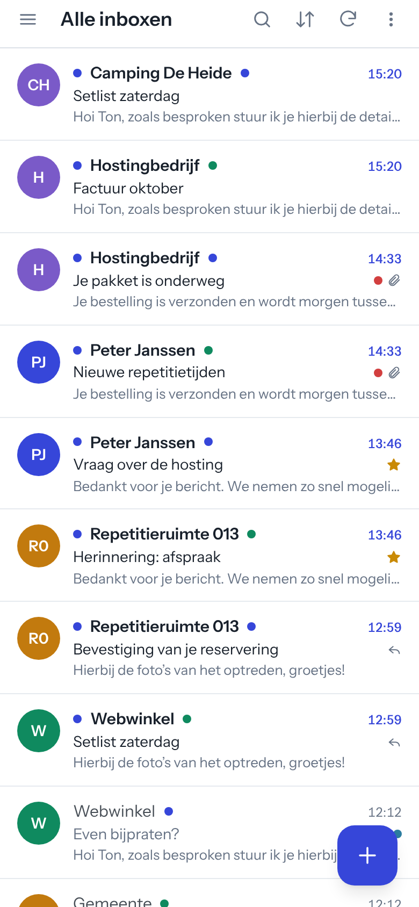
  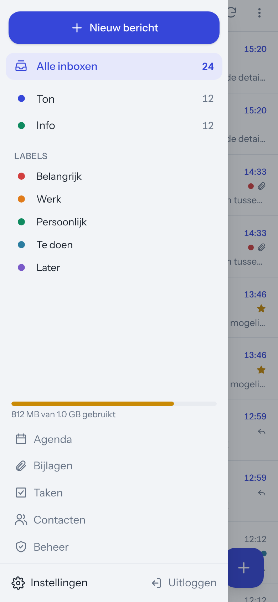
  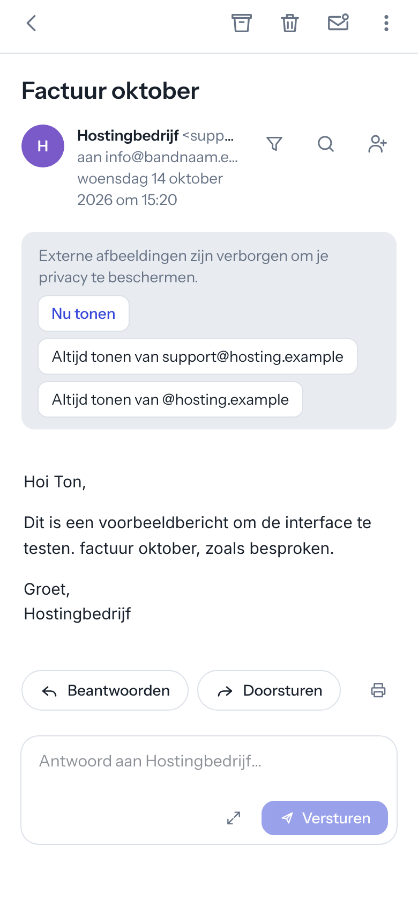

**Offline lezen**: zet onder **Instellingen → Algemeen** de optie **Offline lezen op dit apparaat** aan. Postvak
bewaart dan de berichten die je opent en de nieuwste berichten van je lijsten op dat apparaat. Zonder internet
(in de trein, in het vliegtuig) kun je ze gewoon lezen; bovenin staat dan **Je bent offline**. Uitzetten wist
de bewaarde berichten; uitloggen ook. Zet het alleen aan op een apparaat dat van jou is.

## 3. Het scherm

Op de computer zie je drie kolommen:

1. **Links**: de knop **Nieuw bericht**, je mappen (of bij meerdere accounts **Alle inboxen**), je labels en
   onderaan hoe vol je mailbox is, Agenda, Bijlagen, Taken, Contacten, Instellingen en Uitloggen.
2. **Midden**: de berichtenlijst. Bovenaan: zoeken, sorteren, vernieuwen en het menu **⋮** (alles als gelezen
   markeren, sneltoetsen).
3. **Rechts**: het geopende bericht.

De kolommen kun je breder of smaller maken door de scheidingslijn te verslepen (dubbelklik zet hem terug).
Op een telefoon zie je één ding tegelijk: tik op **☰** linksboven voor de mappen en op **+** rechtsonder
voor een nieuw bericht.

**Meer berichten**: de lijst laat eerst een deel van je berichten zien (op de telefoon 25, op de computer 50) en
laadt de rest als je naar beneden scrolt, of met de knop **Meer berichten laden** onderaan. Hoeveel het er per
keer zijn, stel je in onder **Instellingen → Algemeen**.

**Vernieuwen**: Postvak kijkt zelf elke minuut naar nieuwe mail. Op de telefoon kun je de lijst ook naar
beneden trekken.

**Opslag**: links onder je mappen zie je hoeveel ruimte je mailbox gebruikt, bijvoorbeeld *470 kB van 50 MB
gebruikt*. Is hij bijna vol (90% of meer), dan wordt de balk rood. Ruim dan de prullenbak, spam en oude mail
met grote bijlagen op (zie [Alle bijlagen op een rij](#alle-bijlagen-op-een-rij)). Niet elke mailserver geeft dit
door; dan zie je de balk niet.

### Inboxtabbladen

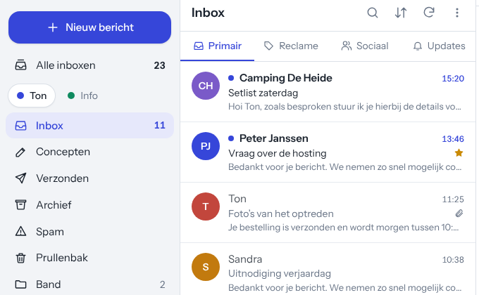

Wil je, zoals in Gmail, je inbox opgesplitst zien? Zet dan onder **Instellingen → Algemeen** de
**Inboxtabbladen** aan. Bovenaan de inbox verschijnen vier tabbladen:

- **Primair**: mail van mensen, en alles wat niet in een ander tabblad hoort;
- **Reclame**: nieuwsbrieven en aanbiedingen (mail met een afmeldlink);
- **Sociaal**: meldingen van Facebook, LinkedIn, Instagram en dergelijke;
- **Updates**: automatische berichten zoals orderbevestigingen, facturen en meldingen van systemen.

De mail blijft gewoon in je inbox staan: de tabbladen zijn alleen een manier van kijken. Zoek je iets, dan zoekt
Postvak in de hele inbox.

## 4. Mail lezen

Klik of tik op een bericht om het te openen. Bovenaan staan de knoppen om het te archiveren, verwijderen,
als spam te markeren, te snoozen, te verplaatsen, er een taak van te maken, labels te geven, als ongelezen te
markeren of een ster te geven.

Op een **telefoon** staan bovenaan alleen de drie meest gebruikte knoppen, extra groot: **archiveren**,
**verwijderen** en **ongelezen**. Alle andere acties zitten onder **⋮** (meer acties), zoals in Gmail.

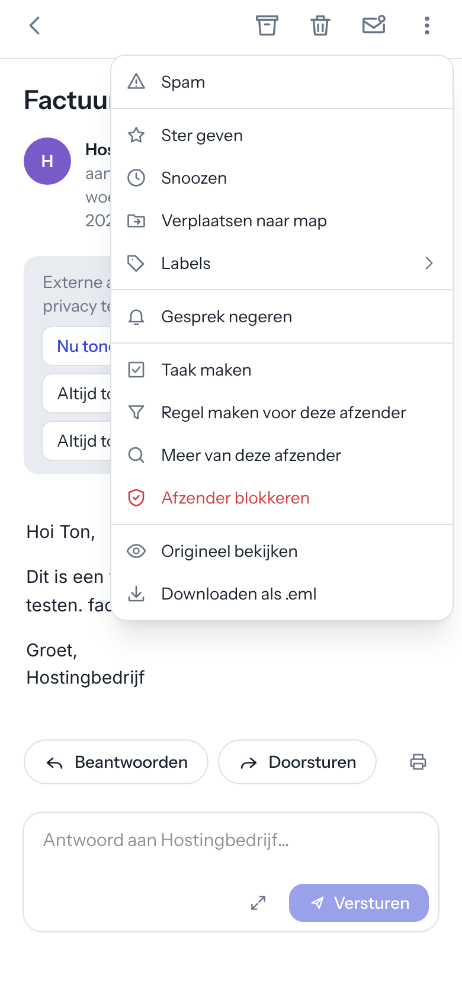

- **Gesprekken**: antwoorden op elkaar staan bij elkaar, inclusief je eigen antwoorden uit Verzonden. Klik op
  een ingeklapt bericht om het te openen. (Uitzetten kan onder Instellingen → Algemeen.)
- **Afbeeldingen**: plaatjes van internet worden eerst niet geladen, zodat afzenders niet kunnen zien dat je
  hun mail opent. Kies **Nu tonen**, of **Altijd tonen** voor die afzender of dat domein.
- **Bijlagen**: afbeeldingen en pdf's open je in Postvak zelf; andere bestanden download je.
- **Bij de afzender** staan drie knoppen: **een regel maken** (trechter), **meer van deze afzender** (vergrootglas)
  en **aan contacten toevoegen**.
- **Uitnodigingen** voor een afspraak verschijnen als kaartje met **Ja**, **Misschien** en **Nee**. Je antwoord
  gaat naar de organisator en de afspraak komt in je agenda.
- **Afdrukken**: het printer-icoon onder het bericht.
- **Origineel bekijken**: onder **⋮** (meer acties) zie je het bericht zoals het binnenkwam, met alle
  technische kopregels. Met **Downloaden als .eml** bewaar je het als bestand, bijvoorbeeld om het aan je
  beheerder of een helpdesk te sturen.

### Waarschuwing bij verdachte mail

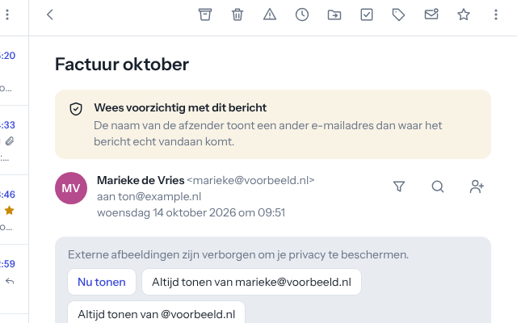

Postvak kijkt bij elk bericht of de afzender is wie hij zegt te zijn. Klopt er iets niet, dan staat er een
balk boven het bericht:

- **Rood – Pas op: dit bericht is mogelijk vervalst**: de mailserver kon de afzender niet controleren, of het
  domein van de afzender zegt zelf dat dit bericht niet van hen komt. Klik niet op links, open geen bijlagen en
  geef nooit wachtwoorden of bankgegevens.
- **Geel – Wees voorzichtig**: bijvoorbeeld als de naam van de afzender een ander e-mailadres laat zien dan
  waar het bericht echt vandaan komt (zoals *klantenservice@bank.nl* &lt;iemand@gmail.com&gt;), of als een
  antwoord naar een heel ander domein zou gaan.

Twijfel je? Neem dan contact op met de afzender via een adres of telefoonnummer dat je zelf al had.

### Uitschrijven van nieuwsbrieven

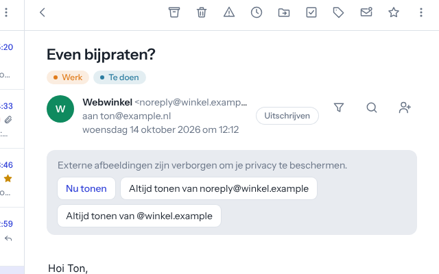

Bij nieuwsbrieven en reclamemail staat naast de afzender de knop **Uitschrijven**. Postvak meldt je dan met één
klik af (bij de meeste afzenders zonder dat je een website hoeft te openen). Kan dat niet, dan opent Postvak de
afmeldpagina van de afzender in een nieuw tabblad.

### Herinnering: er kwam nog geen antwoord

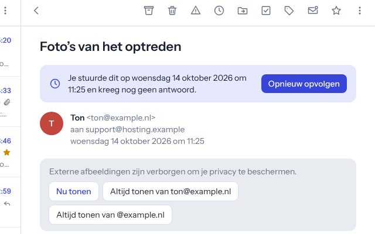

Heb je bij het versturen gekozen voor een herinnering (zie [Mail schrijven](#8-mail-schrijven)) en kwam er geen
antwoord, dan staat jouw bericht weer bovenaan je inbox, met een ster. Bovenaan het bericht staat wanneer je het
stuurde, met de knop **Opnieuw opvolgen** om meteen een vriendelijke herinnering te sturen.

## 5. Mail opruimen

| Wat | Computer | Telefoon / tablet |
| --- | --- | --- |
| Archiveren | knop of `e` | naar rechts vegen (standaard) |
| Verwijderen | knop, `#` of `Delete` | naar links vegen (standaard) |
| Spam | knop of `!` | knop in het bericht |
| Verplaatsen | knop, of slepen naar een map | knop in het bericht |
| Snoozen | knop of `b` | knop in het bericht |

- **Ongedaan maken**: na archiveren, verwijderen, verplaatsen, en na het in één keer markeren van meerdere
  berichten of het geven van een label, verschijnt onderin **Ongedaan maken**. Hoe lang die knop blijft staan
  stel je in onder **Instellingen → Vegen**.
- **Meerdere berichten tegelijk**: klik op de ronde letter-afbeelding (avatar) voor een bericht, of houd een
  bericht op de telefoon even vast. Daarna kun je ze samen archiveren, verwijderen, verplaatsen of markeren.
- **Vegen** op de telefoon: kies onder **Instellingen → Vegen** wat naar links en naar rechts vegen doet.
- **Snoozen**: het bericht verdwijnt tijdelijk en komt terug in je inbox op het moment dat je kiest (later
  vandaag, morgen, dit weekend, volgende week of een eigen tijd). Gesnoozede mail staat in de map **Gesnoozed**.
- **Prullenbak en spam leegmaken**: open de map en kies **Prullenbak legen** (of spam legen) bovenaan de lijst.
- **Mappen** maken, hernoemen en verwijderen doe je onder **Instellingen → Mappen**.
- **Rechtermuisknop**: klik op de computer met de rechtermuisknop op een bericht in de lijst voor een menu met
  openen, beantwoorden, allen beantwoorden, doorsturen, archiveren, verwijderen, spam, (on)gelezen, ster, snoozen,
  verplaatsen, labels, een taak of regel maken en meer van deze afzender. Heb je meerdere berichten geselecteerd,
  dan werkt het menu op allemaal.
- **Na verwijderen of archiveren**: standaard ga je terug naar de lijst. Onder **Instellingen → Algemeen** kun
  je kiezen dat Postvak meteen het **volgende** (nieuwere) of **vorige** (oudere) bericht opent, handig als je
  een stapel mail achter elkaar wegwerkt.
- **Gesprek negeren**: zit je in een groepsmail die je niet meer wilt volgen? Kies onder **⋮** **Gesprek
  negeren**. Het gesprek gaat naar het archief en nieuwe antwoorden komen niet meer in je inbox, maar gaan
  gelezen naar het archief. Terugdraaien: open het gesprek in het archief en kies **Gesprek niet meer negeren**.
- **Afzender blokkeren**: kies onder **⋮** **Afzender blokkeren**. Het bericht gaat naar de prullenbak en Postvak
  maakt een regel, zodat ook toekomstige mail van dat adres meteen in de prullenbak belandt. Spijt? Klik op
  **Ongedaan maken**, of verwijder de regel onder **Instellingen → Regels en afwezig**.

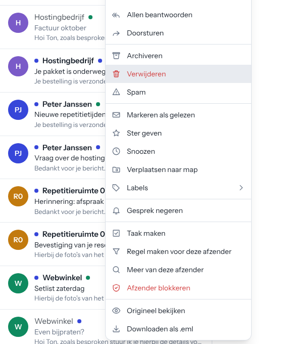

## 6. Zoeken en filteren

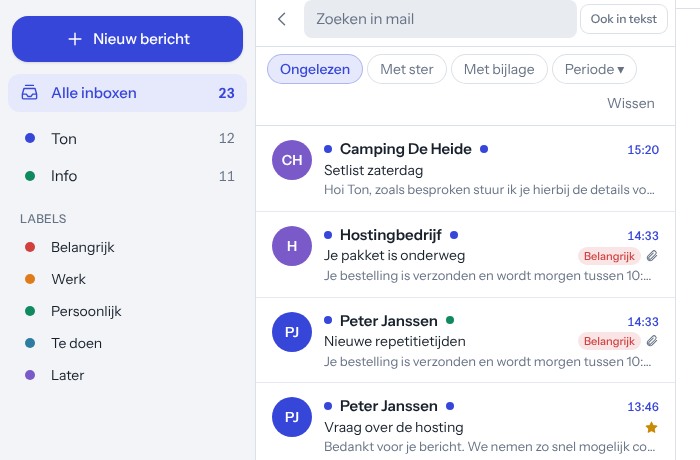

Klik op het vergrootglas (of druk op `/`) en typ een naam, adres of onderwerp. Met **Ook in tekst** zoek je ook
in de berichten zelf (dat is wat langzamer).

Onder het zoekveld staan filters die je kunt combineren:

- **Ongelezen**, **Met ster**, **Met bijlage**
- **Periode**: afgelopen week, maand of jaar
- **Van: …**: verschijnt als je in een bericht op **Meer van deze afzender** klikt

**Wissen** zet alle filters uit; de pijl terug sluit het zoeken.

### Alle bijlagen op een rij

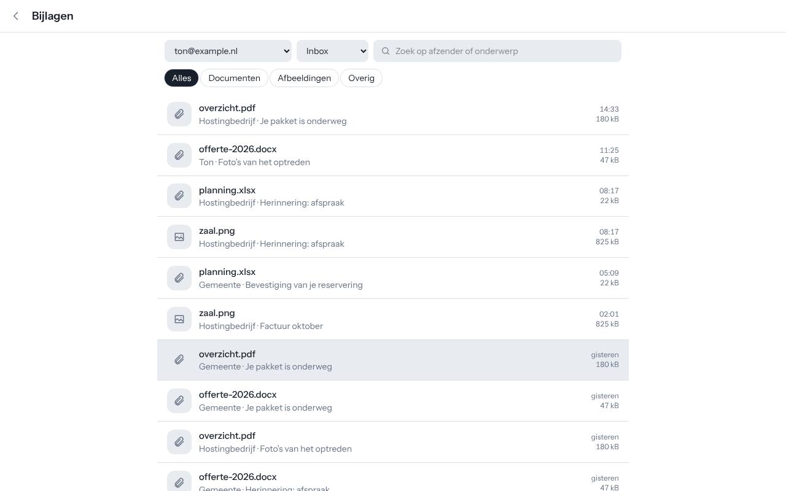

Zoek je dat ene pdf'je of die foto? Kies links **Bijlagen**. Je ziet alle bestanden uit een map, het nieuwste
bovenaan, met de afzender, het onderwerp, de datum en de grootte.

- Kies bovenaan het **account** en de **map**.
- Met **Documenten**, **Afbeeldingen** en **Overig** zie je alleen dat soort bestanden.
- Het zoekveld zoekt op **afzender of onderwerp**.
- Klik op een bestand om het bericht te openen; daar open of download je de bijlage.

Postvak haalt voor dit overzicht alleen de namen en groottes op, niet de bestanden zelf, dus het gaat snel en
kost geen extra dataverbruik.

## 7. Labels

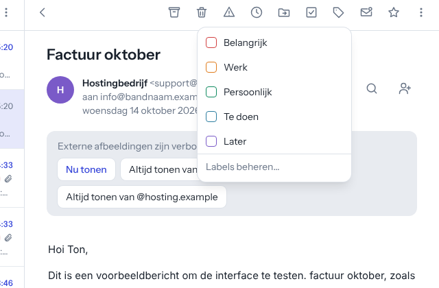

Met labels geef je berichten een gekleurd etiket, bijvoorbeeld **Belangrijk**, **Werk** of **Te doen**. Een
bericht kan meerdere labels hebben.

- Een label geven: het label-icoon in het bericht, of selecteer meerdere berichten.
- Alleen berichten met een label zien: klik links op het label.
- Labels toevoegen, hernoemen of een andere kleur geven: **Instellingen → Weergave**.
- De vijf standaardlabels zijn dezelfde als in **Thunderbird**, dus je ziet ze in beide programma's.

## 8. Mail schrijven

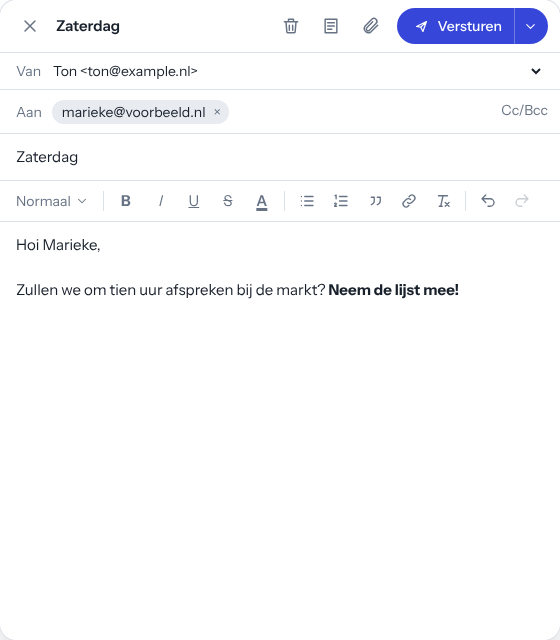

Klik op **Nieuw bericht** (of druk op `c`). Begin bij **Aan** te typen: Postvak vult adressen aan uit je
contacten en uit mensen die je eerder mailde.

**Een hele groep mailen**: typ de naam van een groep uit je contacten (bijvoorbeeld *Werk* of *Band*). Bovenaan
de suggesties staat de groep met 👥 en het aantal personen; kies hem en iedereen uit die groep staat erbij.
Werkt bij **Aan**, **Cc** en **Bcc** (handig voor een groep die elkaars adres niet hoeft te zien).

- **Opmaak**: kopjes, vet, cursief, onderstrepen, kleur, lijsten, citaat en links. Tekst uit Word plakt netjes.
- **Bijlagen**: de paperclip, of sleep bestanden op het venster. Een plaatje kun je ook plakken.
- **Van**: heb je meer adressen, kies dan bovenin vanaf welk adres je verstuurt. Bij een antwoord kiest Postvak
  zelf het adres waarop de mail binnenkwam.
- **Concepten** worden een paar seconden na elke wijziging bewaard. Sluit je het venster, dan staat het concept in
  de map Concepten.
- **Versturen ongedaan maken**: na **Versturen** heb je een paar seconden om het terug te halen
  (instelbaar onder Instellingen → Algemeen).
- **Later versturen**: het pijltje naast **Versturen** → kies een moment. Het bericht staat tot dan in de map
  **Gepland**.
- **Herinner me als er geen antwoord komt**: het pijltje naast **Versturen** → kies onder
  *Herinner me als er geen antwoord komt* na hoeveel dagen (1, 3 of 7). Naast de knop staat dan *Herinnering na … dag(en)*. Komt er in die tijd geen
  antwoord, dan zet Postvak je bericht weer bovenaan je inbox (zie [Mail lezen](#herinnering-er-kwam-nog-geen-antwoord)).
  Komt er wel een antwoord, dan gebeurt er niets.
- **Sjablonen**: het sjablonen-icoon bovenin. Kies een sjabloon om de tekst in te voegen, of bewaar je huidige
  tekst als nieuw sjabloon.
- **Ctrl + Enter** verstuurt het bericht.

### Snel antwoorden

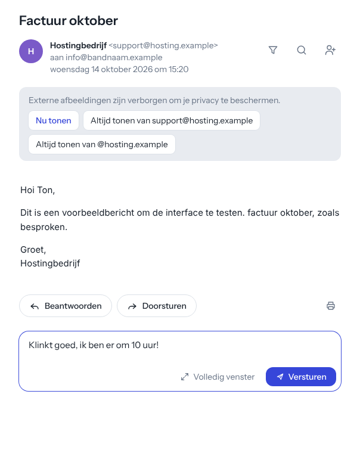

Onder elk geopend bericht staat een vak **Antwoord aan …**. Typ je antwoord en klik op **Versturen** (of
Ctrl + Enter). Je handtekening en het oorspronkelijke bericht gaan gewoon mee, en ook hier kun je het versturen
nog even ongedaan maken.

- Staan er meer mensen op het bericht? Klik dan op **Allen beantwoorden**.
- Wil je toch opmaak of een bijlage? **Volledig venster** opent het gewone schrijfvenster met je tekst erin.

### Handtekeningen

Onder **Instellingen → Accounts → Bewerken** stel je per adres een of meer handtekeningen in, met opmaak en een
afbeelding (bijvoorbeeld je bedrijfslogo). Het logo wordt in de mail zelf meegestuurd, zodat de ontvanger het
meteen ziet.

- Met **Handtekening toevoegen** maak je er nog een, bijvoorbeeld een uitgebreide **Zakelijk** en een **Kort**
  voor snelle antwoorden. Geef ze een naam, zodat je ze makkelijk herkent.
- Kies welke handtekening **standaard bij nieuwe berichten** komt en welke **bij antwoorden en doorsturen** (of
  **Geen handtekening**).
- In het schrijfvenster wissel je met het handtekening-icoon bovenin van handtekening; de oude wordt dan
  vervangen.

## 9. Grote bestanden versturen

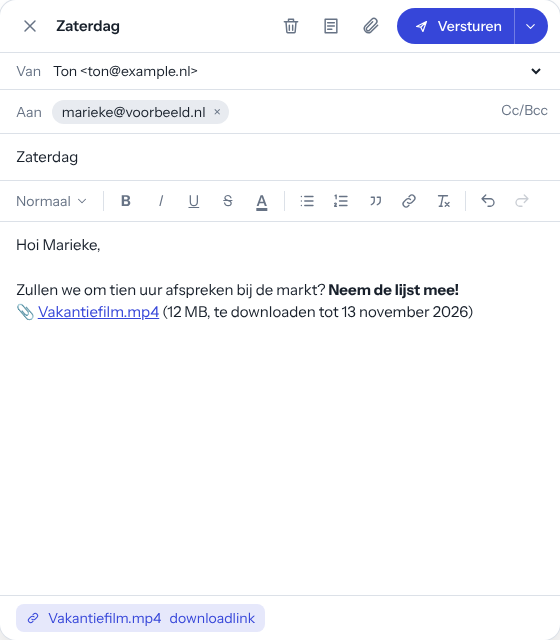

Bestanden groter dan 10 MB, of te groot voor de mailserver, stuurt Postvak automatisch als **downloadlink**:

1. Voeg het bestand toe zoals een gewone bijlage. Onderin zie je hoe ver het uploaden is.
2. Als het klaar is, staat er een link in je bericht (boven je handtekening).
3. De ontvanger klikt op de link en krijgt een pagina met een knop **Downloaden**.

De bestanden staan op je eigen Postvak-server, niet bij een andere dienst. Een link werkt **30 dagen**, daarna
wordt het bestand vanzelf verwijderd. Onder **Instellingen → Privacy** zie je al je gedeelde bestanden, hoe vaak
ze zijn gedownload, en kun je de link kopiëren of het bestand eerder weghalen. Een bestand mag maximaal 2 GB zijn.

## 10. Meerdere mailadressen

Onder **Instellingen → Accounts** voeg je andere mailadressen toe (bijvoorbeeld info@ van je bedrijf). Je
logt daarna nog steeds één keer in.

- **Alle inboxen** laat de inboxen van al je adressen samen zien; elk bericht heeft een gekleurd stipje van zijn
  account. Klik links op een account voor de mappen van dat adres.
- Liever elk adres apart? Zet **Alle inboxen samen tonen** uit onder Instellingen → Algemeen.
- Per account kies je een naam, kleur, handtekening en of je er meldingen van wilt.

## 11. Regels en afwezigheidsmelding

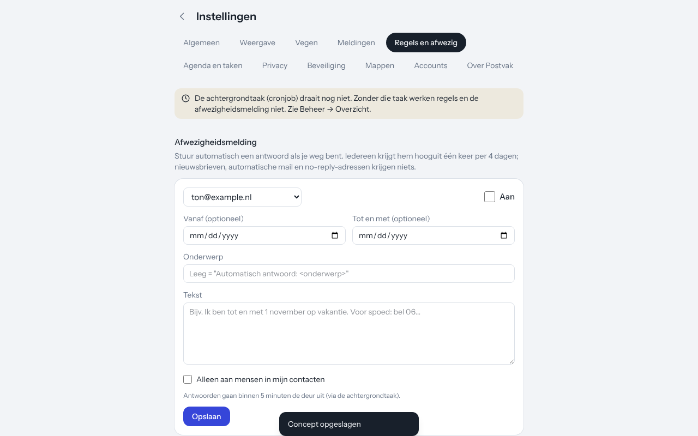

Onder **Instellingen → Regels en afwezig**.

**Regels** sorteren nieuwe mail in je inbox automatisch. Een regel heeft één of meer voorwaarden (afzender,
ontvanger, onderwerp of alles; bevat, bevat niet, is, begint met, eindigt op) en een actie: verplaatsen naar een
map, als gelezen markeren, een ster geven, een label geven of weggooien. Een regel maken vanuit een bericht kan
ook: klik op de trechter naast de afzender.

**Afwezigheidsmelding**: zet hem aan, kies eventueel een begin- en einddatum en schrijf je tekst. Iedereen krijgt
het antwoord hooguit één keer per vier dagen; nieuwsbrieven, automatische mail en no-reply-adressen krijgen niets.
Met **Alleen aan mensen in mijn contacten** beperk je het verder.

> Regels en de afwezigheidsmelding draaien op de server via de achtergrondtaak (cronjob), elke paar minuten.
> Ze werken dus ook als Postvak niet openstaat. Zet niet tegelijk een automatisch antwoord bij je hostingpartij
> aan, anders krijgen mensen er twee.

## 12. Agenda

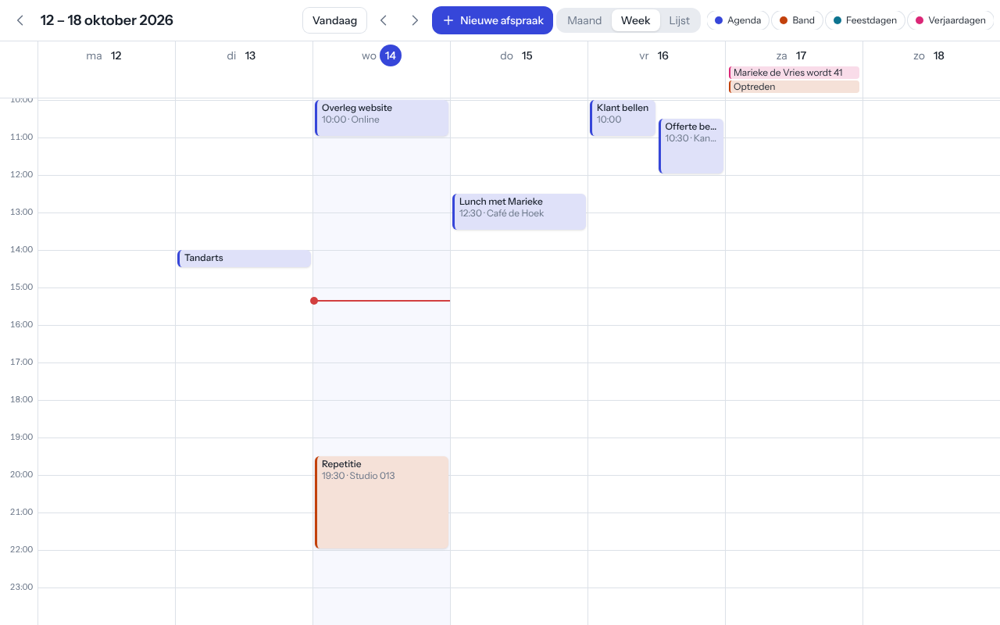

Kies links **Agenda**. Je hebt een maand-, week-, dag- en lijstweergave.

- **Afspraak maken**: klik op een tijdstip of op **Nieuwe afspraak**. Je kunt een plaats, beschrijving,
  herhaling (bijv. elke week) en herinnering instellen. Herinneringen komen als melding op je telefoon of
  computer.
- **Meerdere agenda's**: maak er meer aan onder **Instellingen → Agenda en taken**, ieder met een eigen kleur.
- **Verjaardagen**: de verjaardagen van je contactpersonen staan vanzelf in de agenda, als hele-dag-item (met de
  leeftijd als je het geboortejaar weet). Klik erop om het contact te openen. Met het knopje **Verjaardagen**
  bovenaan verberg je ze even; helemaal uitzetten kan onder **Instellingen → Agenda en taken**.

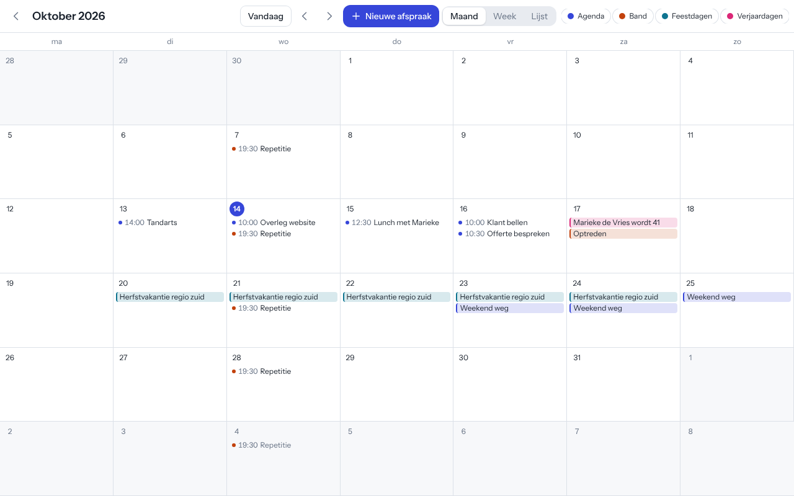
- **Uitnodigingen** die je per mail krijgt, beantwoord je vanuit het bericht (zie [Mail lezen](#4-mail-lezen)).
- **Agenda van elders** (bijvoorbeeld Google, Outlook, je sportclub of de feestdagen): plak het iCal-adres onder
  Instellingen → Agenda en taken → **Agenda van elders toevoegen**. Postvak haalt hem elk half uur op; je kunt
  hem alleen lezen. Bij een Google-agenda gebruik je het **Geheime adres in iCal-indeling**; de stappen staan op
  die pagina.
- **Je Postvak-agenda in Google of Outlook zien**: maak bij de agenda een **Deellink** en voeg die in Google
  toe via **Andere agenda's → + → Via URL**.

## 13. Taken

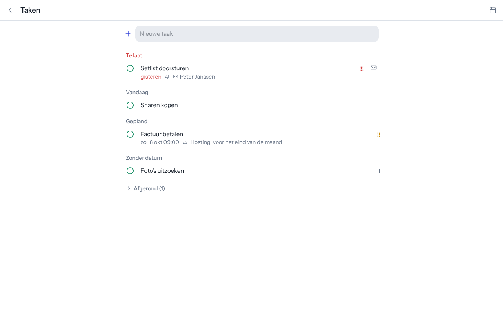

Kies links **Taken**. Je kunt meerdere takenlijsten hebben, met een vervaldatum, prioriteit en herinnering per
taak. Van een mail maak je met één klik een taak: het vinkje-icoon bovenaan een geopend bericht.

## 14. Contacten

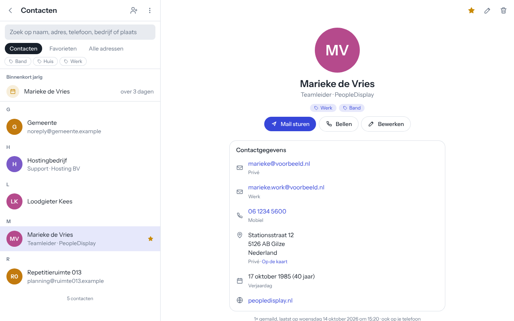

Kies links **Contacten**. Net als bij Google Contacten heeft elk contact een eigen kaart met:

- een **foto**, **voornaam en achternaam**, bijnaam, **bedrijf, functie en afdeling**;
- meerdere **e-mailadressen** en **telefoonnummers**, elk met een soort (privé, werk, mobiel, …);
- **adressen** (met een link naar de kaart), een **verjaardag** (ook zonder jaar), **websites** en **notities**;
- **groepen**, zoals Familie, Werk of Band. Klik bovenaan de lijst op een groep om alleen die contacten te zien.

Met **Mail sturen** en **Bellen** neem je direct contact op. Wie de komende week jarig is, staat bovenaan de
lijst onder **Binnenkort jarig**. Zoeken werkt op naam, adres, telefoon, bedrijf, plaats en groep.

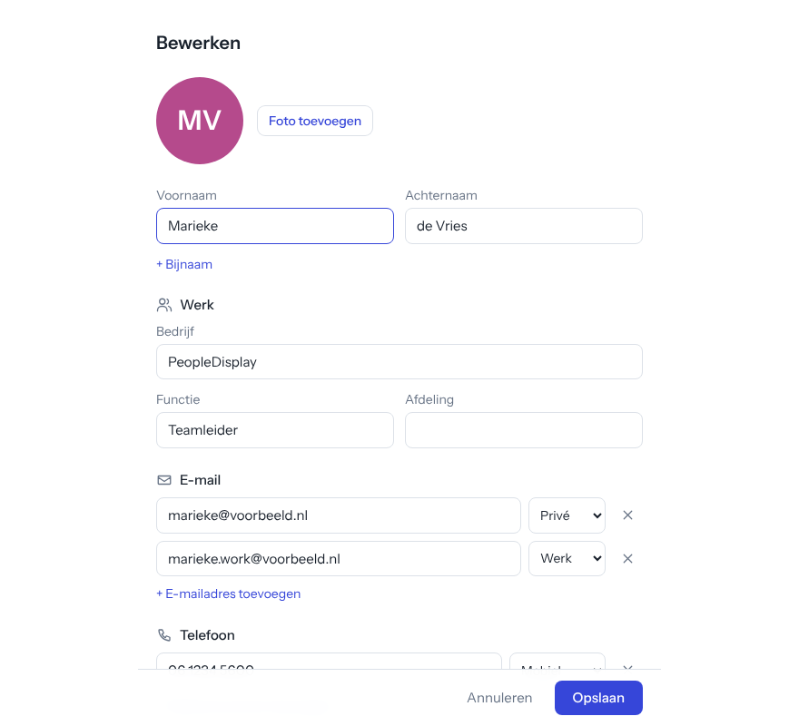

- **Bewerken**: klik op **Bewerken** op de kaart. Met **+ E-mailadres toevoegen**, **+ Telefoonnummer
  toevoegen** enzovoort voeg je extra regels toe; met **Foto toevoegen** kies je een foto (Postvak maakt hem
  vierkant en klein).
- **Importeren en exporteren** gaat met vCard-bestanden (.vcf), bijvoorbeeld uit Google Contacten, Outlook of je
  telefoon. Bedrijf, adressen, verjaardag en groepen komen mee.
- **Alle adressen** laat ook mensen zien die Postvak automatisch onthield toen je ze mailde.
- Alles, ook de foto, synchroniseert met de contacten-app op je telefoon (zie
  [hoofdstuk 15](#15-agenda-taken-en-contacten-op-je-telefoon)).

## 15. Agenda, taken en contacten op je telefoon

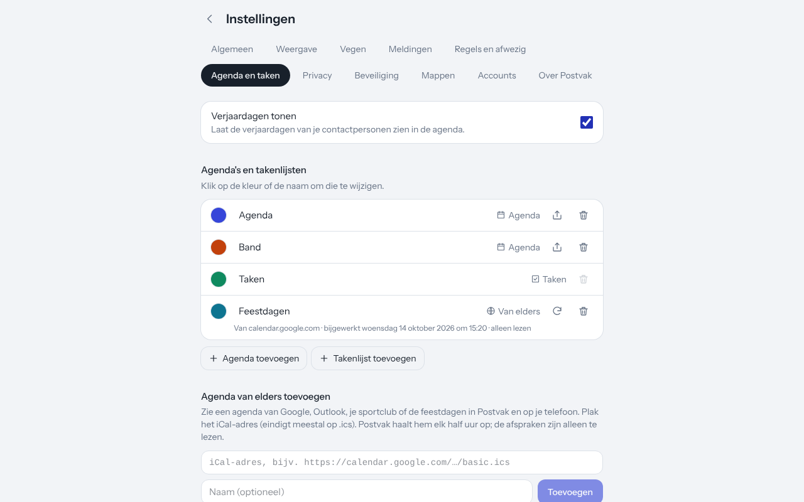

Je agenda, taken en contacten kunnen ook in de gewone apps van je telefoon of computer staan. Wijzigingen gaan
beide kanten op. Zo stel je het in:

1. Ga naar **Instellingen → Agenda en taken**, kopje **Op je telefoon of computer**.
2. Maak een **app-wachtwoord** voor je apparaat (bijvoorbeeld "iPhone"). Je mailboxwachtwoord werkt hier niet:
   zo kun je een kwijtgeraakte telefoon apart afsluiten met **Intrekken**.
3. Kopieer het wachtwoord meteen: Postvak laat het maar één keer zien.
4. Volg de stappen voor je apparaat op die pagina (**Zo stel je het in**):
   - **iPhone en iPad**: Instellingen → Apps → Agenda → Agenda-accounts → Voeg account toe → Andere →
     CalDAV-account. Taken komen in Herinneringen. Voor contacten hetzelfde met een CardDAV-account.
   - **Android**: installeer de app **DAVx⁵** en log in met URL en gebruikersnaam. Voor taken werkt DAVx⁵ samen
     met bijvoorbeeld Tasks.org.
   - **Mac**: Systeeminstellingen → Internetaccounts → CalDAV-account (en CardDAV-account).
   - **Thunderbird**: Nieuwe agenda → Op het netwerk, en Nieuw adresboek → CardDAV.

De server en je gebruikersnaam staan op die pagina klaar om over te nemen.

## 16. Meldingen bij nieuwe mail

Onder **Instellingen → Meldingen** zet je meldingen aan voor het apparaat waarop je dat doet. Doe dat op elk
apparaat waar je ze wilt krijgen. Met **Testmelding** controleer je of het werkt.

- Op **iPhone en iPad** werken meldingen alleen als Postvak op je beginscherm staat (zie
  [hoofdstuk 2](#2-postvak-als-app-op-je-telefoon-tablet-of-computer)); open het vanaf daar.
- Heb je meerdere adressen, dan kies je per adres of je er meldingen van wilt.
- Krijg je de melding dat meldingen geblokkeerd zijn? Klik in de browser op het slotje of de schuifjes links van
  het adres, zet **Meldingen** op **Toestaan** en laad de pagina opnieuw.

## 17. Instellingen

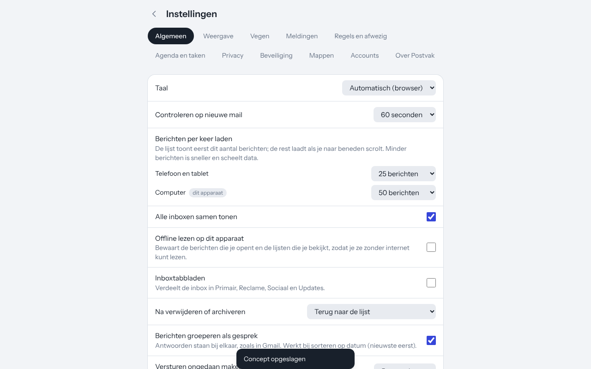

Klik links onderaan op **Instellingen**.

| Tabblad | Wat stel je hier in |
| --- | --- |
| **Algemeen** | Taal, hoe vaak Postvak naar nieuwe mail kijkt, berichten per keer laden (telefoon/tablet en computer), offline lezen, inboxtabbladen, wat er gebeurt na verwijderen of archiveren, Alle inboxen, gesprekken, versturen ongedaan maken, als gelezen markeren bij openen, versie en updates, uitloggen |
| **Weergave** | Licht of donker, accentkleur, tekstgrootte, ruim of compact, labels beheren |
| **Vegen** | Wat naar links en naar rechts vegen doet, hoe lang Ongedaan maken blijft staan, bevestiging bij verwijderen |
| **Meldingen** | Meldingen op dit apparaat, per account aan of uit, testmelding |
| **Regels en afwezig** | Regels voor nieuwe mail en de afwezigheidsmelding |
| **Agenda en taken** | Verjaardagen tonen, agenda's en takenlijsten, agenda's van elders, deellinks, synchroniseren met je telefoon |
| **Privacy** | Externe afbeeldingen, veilige afzenders, grote bestanden (downloadlinks) |
| **Beveiliging** | Tweestapsverificatie aan of uit, herstelcodes, onthouden apparaten |
| **Mappen** | Mappen maken, hernoemen en verwijderen |
| **Accounts** | Mailadressen toevoegen, naam, kleur en handtekeningen |
| **Over Postvak** | Versie, wie Postvak maakt, licentie en links |

  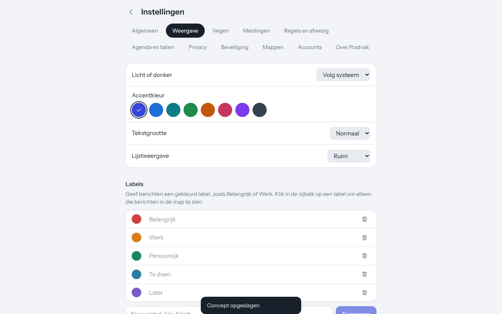
  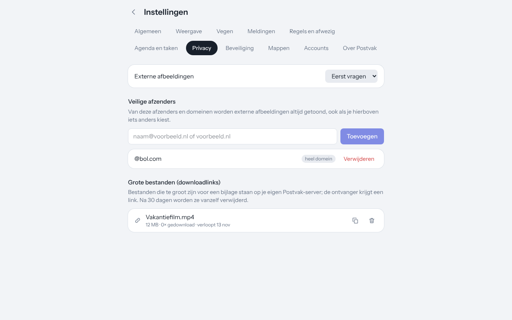

## 18. Sneltoetsen

Op de computer werkt Postvak ook met het toetsenbord. Druk op `?` voor dit overzicht in Postvak zelf.

| Toets | Doet |
| --- | --- |
| `j` / `k` | Volgend / vorig bericht |
| `Esc` | Bericht sluiten |
| `r` | Beantwoorden |
| `a` | Allen beantwoorden |
| `f` | Doorsturen |
| `c` | Nieuw bericht |
| `e` | Archiveren |
| `#` of `Delete` | Verwijderen |
| `!` | Spam |
| `b` | Snoozen |
| `x` | Selecteren |
| `/` | Zoeken |
| `Ctrl + Enter` | Versturen (in het schrijfvenster en bij snel antwoorden) |
| `?` | Overzicht van sneltoetsen |

## 19. Privacy en veiligheid

- Je mail blijft op je eigen mailserver; Postvak bewaart er geen kopie van (alleen de korte voorbeeldregel voor
  de berichtenlijst). Agenda, taken en contacten staan in de database van je eigen Postvak.
- Mailboxwachtwoorden worden versleuteld opgeslagen.
- De opmaak van binnenkomende mail wordt op de server én in de browser schoongemaakt en in een afgeschermd
  venster getoond, zodat een mail geen kwaad kan doen.
- Afbeeldingen van internet worden pas geladen als jij dat wilt.
- **Tweestapsverificatie** (Instellingen → Beveiliging) zorgt dat je wachtwoord alleen niet genoeg is om in te
  loggen. Bewaar je herstelcodes op een veilige plek.
- Er gaat niets naar PeopleDisplay, adverteerders of andere partijen. Meldingen lopen via de meldingendienst van
  je browser (Apple, Google of Mozilla), versleuteld.

## 20. Voor de beheerder

De eerste gebruiker die inlogt is beheerder, tenzij de beheerders in `config.php` zijn vastgelegd
(`'admins' => ['jij@voorbeeld.nl']`). Beheerders zien links **Beheer**:

- **Overzicht**: versie, database, achtergrondtaak (cronjob) en eventuele foutmeldingen bij een update.
- **Gebruikers**: wie Postvak gebruikt, en tweestapsverificatie uitzetten voor iemand die zijn telefoon kwijt is.
- **Beveiliging**: mislukte inlogpogingen en blokkades opheffen.
- **Instellingen**: welke maildomeinen mogen inloggen, of gebruikers zelf een server mogen opgeven, en de
  **standaardinstellingen** voor nieuwe gebruikers (vegen, thema, berichten per keer en meer).

De **cronjob** is nodig voor meldingen, regels, afwezigheidsmelding, later versturen, snoozen, herinneringen,
agenda's van elders en het opruimen van verlopen downloadlinks. Hoe je hem instelt staat in
[INSTALL.nl.md](INSTALL.nl.md) en onder Beheer → Overzicht. Updates installeren en de database bijwerken gaat
vanzelf; zie ook de [lijst met wijzigingen](../CHANGELOG.md).

## 21. Vragen en problemen

**Ik zie de nieuwste versie niet op mijn telefoon.**
Open Postvak opnieuw of kies **Instellingen → Algemeen → Op updates controleren**. Verschijnt onderin de balk
**Bijwerken**, tik daar dan op. Heb je een versie van vóór 1.6.1, sluit dan één keer de app helemaal af (en
eventuele browsertabbladen met Postvak) en open hem opnieuw.

**Ik krijg geen meldingen.**
Kijk onder Instellingen → Meldingen of ze aanstaan op dít apparaat en stuur een testmelding. Op iPhone/iPad moet
Postvak op het beginscherm staan. Werkt de testmelding wel maar komen er bij nieuwe mail geen meldingen, vraag
dan je beheerder of de cronjob draait.

**Mijn regel of afwezigheidsmelding doet niets.**
Die worden elke paar minuten door de cronjob uitgevoerd. Bij de regels zie je hoe vaak een regel is toegepast;
staat er een waarschuwing over de achtergrondtaak, waarschuw dan je beheerder.

**Mijn mailbox is (bijna) vol.**
Kijk links onderaan hoeveel ruimte je gebruikt. Leeg de prullenbak en spam, en zoek onder **Bijlagen** naar grote
bestanden die je niet meer nodig hebt. Meer ruimte nodig? Dat regelt je beheerder of hostingpartij.

**Een nieuwsbrief blijft komen, ook na uitschrijven.**
Afmelden kan bij sommige afzenders een paar dagen duren. Blijft het komen, kies dan **⋮ → Afzender blokkeren**.

**Een bijlage is te groot.**
Boven 10 MB maakt Postvak er vanzelf een downloadlink van (zie [hoofdstuk 9](#9-grote-bestanden-versturen)).

**Mijn agenda staat niet op mijn telefoon.**
Controleer of je het app-wachtwoord gebruikt (niet je mailwachtwoord) en of je de server precies zo hebt
overgenomen als op de pagina Instellingen → Agenda en taken staat.

**Ik ben mijn telefoon met de authenticator-app kwijt.**
Log in met een van je herstelcodes, of vraag de beheerder om tweestapsverificatie voor je uit te zetten.

**Een probleem melden of een idee?**
Via [GitHub](https://github.com/peopledisplaynl-coder/postvak/issues), of de link onder
**Instellingen → Over Postvak**.

---

Postvak is gemaakt door [PeopleDisplay](https://peopledisplay.nl) en is open source (MIT-licentie).
Schermafbeeldingen komen uit de demo met voorbeeldgegevens; maak ze opnieuw met `node scripts/manual-screenshots.mjs`.
