# Postvak user guide

Postvak is webmail for your own hosting server: mail, calendar, tasks and contacts in one place, on your
computer, tablet and phone. This guide is for everyone who uses Postvak. Are you the administrator and want to
install it? See the [installation guide](INSTALL.md). (Nederlandse versie: [HANDLEIDING.md](HANDLEIDING.md).)

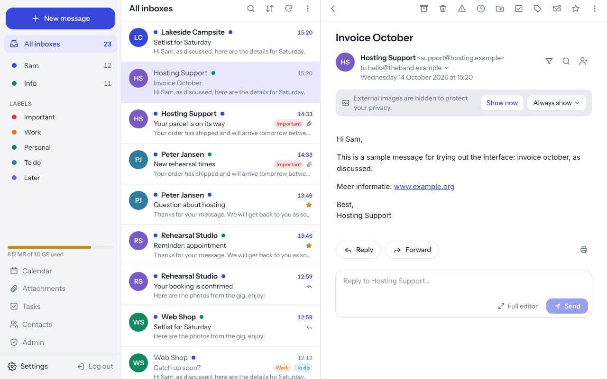

## Contents

1. [Logging in](#1-logging-in)
2. [Postvak as an app on your phone, tablet or computer](#2-postvak-as-an-app-on-your-phone-tablet-or-computer)
3. [The screen](#3-the-screen)
4. [Reading mail](#4-reading-mail)
5. [Tidying up: archive, delete, move, snooze](#5-tidying-up)
6. [Searching and filtering](#6-searching-and-filtering)
7. [Labels](#7-labels)
8. [Writing mail](#8-writing-mail)
9. [Sending large files](#9-sending-large-files)
10. [Several mail addresses](#10-several-mail-addresses)
11. [Rules and out-of-office reply](#11-rules-and-out-of-office-reply)
12. [Calendar](#12-calendar)
13. [Tasks](#13-tasks)
14. [Contacts](#14-contacts)
15. [Calendar, tasks and contacts on your phone](#15-calendar-tasks-and-contacts-on-your-phone)
16. [Notifications for new mail](#16-notifications-for-new-mail)
17. [Settings](#17-settings)
18. [Keyboard shortcuts](#18-keyboard-shortcuts)
19. [Privacy and security](#19-privacy-and-security)
20. [For the administrator](#20-for-the-administrator)
21. [Questions and problems](#21-questions-and-problems)

---

## 1. Logging in

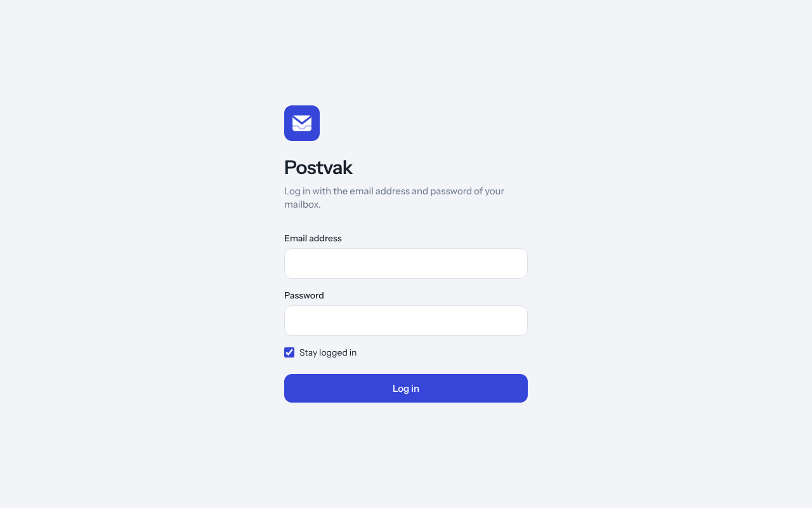

You log in with your **mail address and the password of your mailbox**. Postvak has no passwords of its own: it
checks your details with the mail server.

- **Stay logged in**: tick this on your own device and you stay logged in for 30 days. Leave it off on a shared
  or public computer.
- **Two-step verification**: if you switched it on (see [Settings → Security](#17-settings)), Postvak asks for
  the code from your authenticator app after your password. Lost your phone? Use one of your recovery codes.
- After a few failed attempts, logging in is blocked for a while. Wait a little and try again.

## 2. Postvak as an app on your phone, tablet or computer

Postvak works in any browser, but you can also install it as an app. It then gets its own icon, opens without
an address bar and can show notifications.

| Device | How to install |
| --- | --- |
| **iPhone / iPad** | Open Postvak in **Safari** → tap **Share** (square with an arrow) → **Add to Home Screen**. |
| **Android** | Open Postvak in **Chrome** → menu **⋮** → **Install app** (or **Add to Home screen**). |
| **Computer** | In Chrome or Edge: click the install icon on the right of the address bar, or menu → **Install Postvak**. |

**Updates** happen by themselves. Postvak checks for a new version when it opens, when you come back to the app
and every 30 minutes. If you are not writing, the new version loads straight away; otherwise a bar at the bottom
offers **Update**. You can see your version under **Settings → General**, with the button **Check for updates**.

  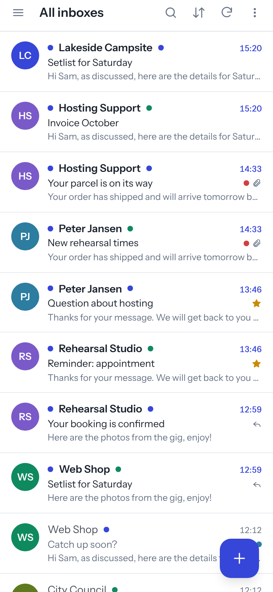
  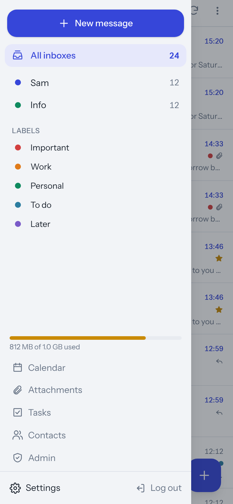
  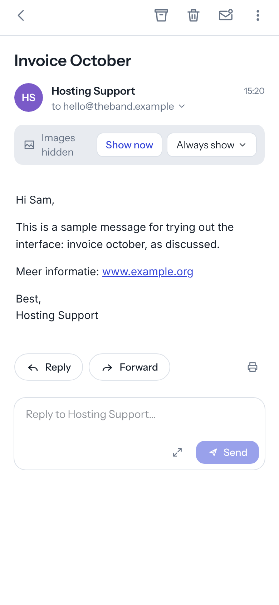

**Offline reading**: switch on **Offline reading on this device** under **Settings → General**. Postvak then keeps
the messages you open and the newest messages of your lists on that device. Without internet (on a train, on a
plane) you can still read them; **You are offline** shows at the top. Switching it off deletes the saved
messages, and so does logging out. Only switch it on for a device that is yours.

## 3. The screen

On a computer you see three columns:

1. **Left**: the **New message** button, your folders (or **All inboxes** if you have several accounts), your
   labels and at the bottom how full your mailbox is, Calendar, Attachments, Tasks, Contacts, Settings and Log out.
2. **Middle**: the message list. At the top: search, sort, refresh and the **⋮** menu (mark all as read,
   keyboard shortcuts).
3. **Right**: the open message.

Drag the dividing line between columns to make them wider or narrower (double-click puts it back). On a phone you
see one thing at a time: tap **☰** at the top left for your folders and **+** at the bottom right for a new
message.

**More messages**: the list first shows part of your messages (25 on a phone, 50 on a computer) and loads the
rest as you scroll down, or with the **Load more messages** button at the bottom. You set how many under
**Settings → General**.

**Refreshing**: Postvak checks for new mail every minute by itself. On a phone you can also pull the list down.

**Storage**: below your folders you see how much space your mailbox uses, for example *470 kB of 50 MB used*.
When it is nearly full (90% or more) the bar turns red. Then empty the trash and spam and clear out old mail with
large attachments (see [All attachments at a glance](#all-attachments-at-a-glance)). Not every mail server
reports this; then there is no bar.

### Inbox tabs

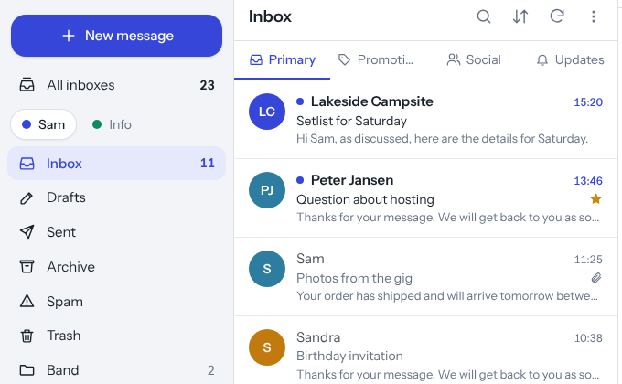

Would you like your inbox split up, as in Gmail? Switch on **Inbox tabs** under **Settings → General**. Four tabs
appear at the top of the inbox:

- **Primary**: mail from people, and everything that does not belong in another tab;
- **Promotions**: newsletters and offers (mail with an unsubscribe link);
- **Social**: notifications from Facebook, LinkedIn, Instagram and the like;
- **Updates**: automatic messages such as order confirmations, invoices and system notifications.

The mail stays in your inbox: the tabs are only a way of looking at it. When you search, Postvak searches the
whole inbox.

**Choosing which tabs you see**: below the Inbox tabs option, tick the tabs you want, just like in Gmail.
**Primary** is always on. Switch off **Social**, for example, and notifications from Facebook and LinkedIn simply
land in Primary.

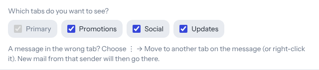

**Moving a message to another tab**: is a message in the wrong tab, say a mail from your sports club in
Promotions? Right-click the message (or choose **⋮** in the open message) → **Move to another tab** and pick the
right one. Postvak remembers this for that sender: their messages already in your inbox move along, and new mail
from that address goes straight to that tab from now on. **Undo** in the notification takes it back at once.

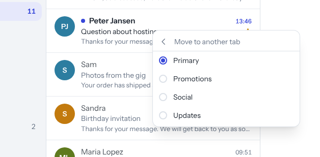

The senders you placed yourself are listed under **Settings → General**, under **Senders you placed yourself**.
Click the cross there to let Postvak sort a sender automatically again.

## 4. Reading mail

Click or tap a message to open it. At the top are the buttons to archive it, delete it, mark it as spam, snooze
it, move it, turn it into a task, give it labels, mark it as unread or star it.

On a **phone** only the three most used buttons are at the top, extra large: **archive**, **delete** and
**unread**. All other actions are under **⋮** (more actions), as in Gmail.

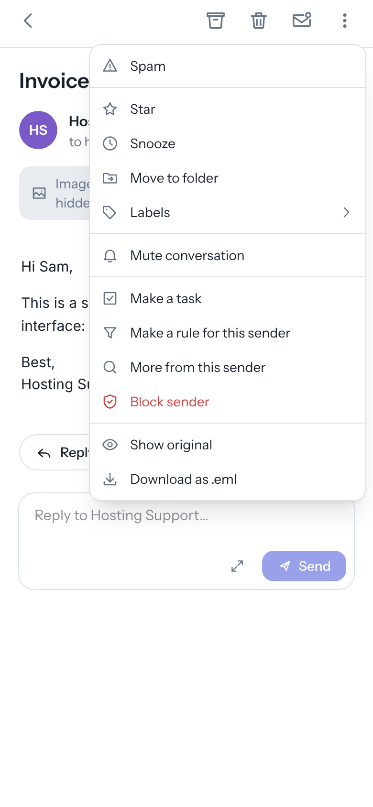

- **Conversations**: replies to each other are kept together, including your own replies from Sent. Click a
  collapsed message to open it. (You can switch this off under Settings → General.)
- **Images**: pictures from the internet are not loaded at first, so senders cannot see that you opened their
  mail. Choose **Show now**, or under **Always show** that sender or the whole domain.
- **Attachments**: images and PDFs open in Postvak itself. In a PDF, zoom with **+** and **−**; **download** and
  **close** (✕) are at the top right. Other files are downloaded.
- **Next to the sender** a computer shows three buttons: **make a rule** (funnel), **more from this sender**
  (magnifier) and **add to contacts**. On a phone, tap **to …** under the name to see the full addresses and date,
  with the same three buttons.
- **Wide newsletters** are fitted to your screen, as in Gmail, so you do not have to scroll sideways. Want the
  message at its original size after all (to zoom in on a detail)? Tap **Show original size** below the message.
- **Invitations** to a meeting appear as a card with **Yes**, **Maybe** and **No**. Your answer goes to the
  organizer and the event is added to your calendar.
- **Print**: the printer icon below the message.
- **Show original**: under **⋮** (more actions) you see the message as it arrived, with all technical headers.
  **Download as .eml** saves it as a file, for example to send to your administrator or a help desk.

### Warning for suspicious mail

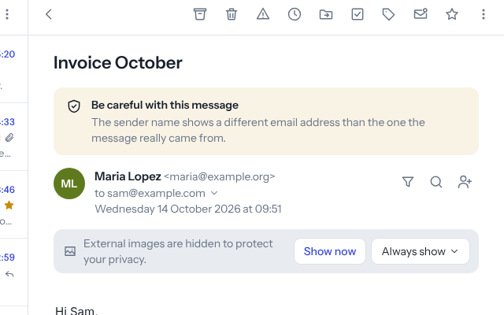

For every message Postvak checks whether the sender is who they claim to be. If something is off, a bar appears
above the message:

- **Red – Careful: this message may be forged**: the mail server could not verify the sender, or the sender's
  domain itself says this message did not come from them. Do not click links, do not open attachments and never
  give passwords or bank details.
- **Amber – Be careful**: for example when the sender name shows a different e-mail address than the one the
  message really came from (such as *service@bank.com* &lt;someone@gmail.com&gt;), or when a reply would go to a
  completely different domain.

In doubt? Contact the sender through an address or phone number you already had.

### Unsubscribing from newsletters

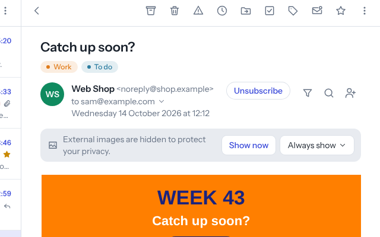

Newsletters and promotional mail have an **Unsubscribe** button next to the sender. Postvak unsubscribes you with
one click (with most senders without opening a website). If that is not possible, Postvak opens the sender's
unsubscribe page in a new tab.

### Reminder: no reply yet

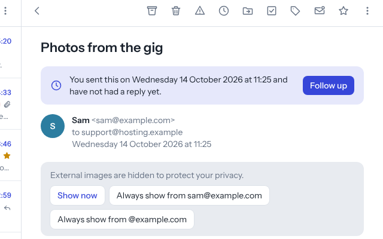

If you asked for a reminder when sending (see [Writing mail](#8-writing-mail)) and no reply came, your message is
back at the top of your inbox, starred. At the top it says when you sent it, with a **Follow up** button to send a
friendly reminder straight away.

## 5. Tidying up

| What | Computer | Phone / tablet |
| --- | --- | --- |
| Archive | button or `e` | swipe right (default) |
| Delete | button, `#` or `Delete` | swipe left (default) |
| Spam | button or `!` | button in the message |
| Move | button, or drag to a folder | button in the message |
| Snooze | button or `b` | button in the message |

- **Undo**: after archiving, deleting or moving, and after marking several messages at once or giving a label,
  **Undo** appears at the bottom. How long it stays is set under **Settings → Swipe**.
- **Several messages at once**: click the round letter picture (avatar) in front of a message, or press and hold
  a message on a phone. Then archive, delete, move or mark them together.
- **Swiping** on a phone: choose under **Settings → Swipe** what swiping left and right does.
- **Snooze**: the message disappears for a while and comes back to your inbox at the time you choose (later
  today, tomorrow, this weekend, next week or a time of your own). Snoozed mail is in the **Snoozed** folder.
- **Emptying trash and spam**: open the folder and choose **Empty trash** (or empty spam) at the top of the list.
- **Folders**: create, rename and delete them under **Settings → Folders**.
- **Right-click**: on a computer, right-click a message in the list for a menu with open, reply, reply all,
  forward, archive, delete, spam, (un)read, star, snooze, move, labels, make a task or rule and more from this
  sender. With several messages selected, the menu works on all of them.
- **After deleting or archiving**: by default you go back to the list. Under **Settings → General** you can have
  Postvak open the **next** (newer) or **previous** (older) message straight away, handy when working through a
  pile of mail.
- **Mute conversation**: in a group mail you no longer want to follow? Choose **Mute conversation** under **⋮**.
  The conversation goes to the archive and new replies skip your inbox: they go to the archive, marked as read.
  To undo: open the conversation in the archive and choose **Unmute conversation**.
- **Block sender**: choose **Block sender** under **⋮**. The message goes to the trash and Postvak makes a rule so
  future mail from that address goes straight to the trash too. Changed your mind? Click **Undo**, or delete the
  rule under **Settings → Rules & away**.

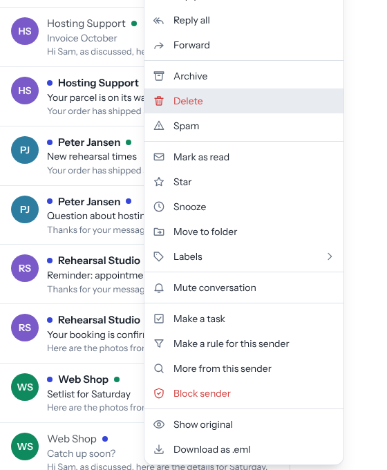

## 6. Searching and filtering

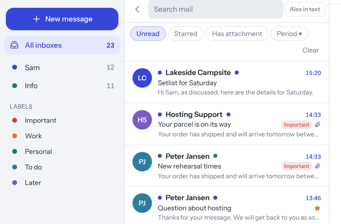

Click the magnifier (or press `/`) and type a name, address or subject. With **Also in text** Postvak also
searches the messages themselves (a little slower).

Below the search field are filters you can combine:

- **Unread**, **Starred**, **Has attachment**
- **Period**: past week, month or year
- **From: …**: appears when you click **More from this sender** in a message

**Clear** switches all filters off; the back arrow closes the search.

### All attachments at a glance

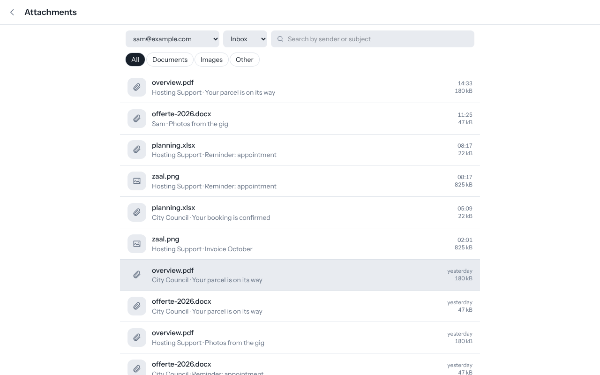

Looking for that one PDF or photo? Choose **Attachments** on the left. You see every file in a folder, newest
first, with the sender, subject, date and size.

- Choose the **account** and **folder** at the top.
- **Documents**, **Images** and **Other** show only that kind of file.
- The search field searches **sender or subject**.
- Click a file to open the message; open or download the attachment from there.

For this overview Postvak only fetches the names and sizes, not the files themselves, so it is quick and uses no
extra data.

## 7. Labels

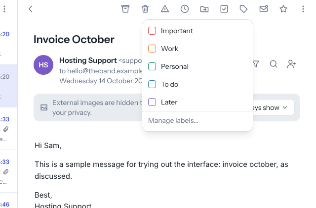

Labels give messages a coloured tag, for example **Important**, **Work** or **To do**. A message can have
several labels.

- Give a label: the label icon in the message, or select several messages.
- Show only messages with a label: click the label on the left.
- Add, rename or recolour labels: **Settings → Appearance**.
- The five standard labels are the same as in **Thunderbird**, so you see them in both programs.

## 8. Writing mail

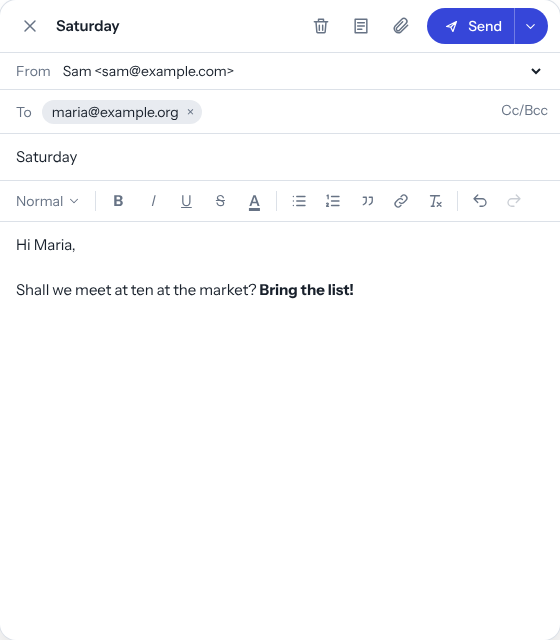

Click **New message** (or press `c`). Start typing in **To**: Postvak completes addresses from your contacts and
from people you mailed before.

**Mailing a whole group**: type the name of a group from your contacts (for example *Work* or *Band*). The group
is at the top of the suggestions with 👥 and the number of people; pick it and everyone in it is added. Works in
**To**, **Cc** and **Bcc** (handy for a group that need not see each other's addresses).

- **Formatting**: headings, bold, italic, underline, colour, lists, quote and links. Text pasted from Word comes
  out clean.
- **Attachments**: the paperclip, or drag files onto the window. You can also paste a picture.
- **From**: with several addresses, choose at the top which one to send from. When replying, Postvak picks the
  address the mail came in on.
- **Drafts** are saved a few seconds after every change. Close the window and the draft is in the Drafts folder.
- **Undo send**: after **Send** you have a few seconds to take it back (set under Settings → General).
- **Send later**: the arrow next to **Send** → choose a moment. Until then the message waits in the
  **Scheduled** folder.
- **Remind me if nobody replies**: the arrow next to **Send** → under *Remind me if nobody replies* choose after
  how many days (1, 3 or 7). Next to the button it then says *Reminder after … day(s)*. If no reply comes in that
  time, Postvak puts your message back at the top of your inbox (see
  [Reading mail](#reminder-no-reply-yet)). If a reply does come, nothing happens.
- **Templates**: the templates icon at the top. Pick a template to insert its text, or save your current text as
  a new template.
- **Ctrl + Enter** sends the message.

### Quick reply

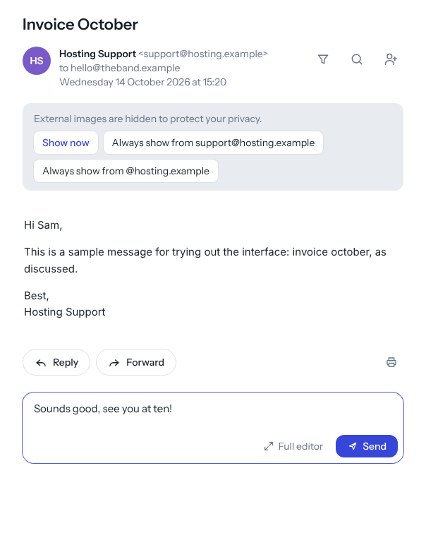

Below every open message is a box **Reply to …**. Type your answer and click **Send** (or Ctrl + Enter). Your
signature and the original message go along as usual, and you can still undo sending for a moment.

- More people on the message? Click **Reply all**.
- Want formatting or an attachment after all? **Full editor** opens the normal compose window with your text in it.

### Signatures

Under **Settings → Accounts → Edit** you set one or more signatures for each address, with formatting and an
image (your company logo, for example). The logo is sent inside the mail itself, so the recipient sees it
straight away.

- **Add signature** makes another one, for example a full **Business** one and a **Short** one for quick replies.
  Give them a name so you recognise them.
- Choose which signature is the **default for new messages** and which **for replies and forwards** (or
  **No signature**).
- In the compose window, the signature icon at the top switches to another signature; the old one is replaced.

## 9. Sending large files

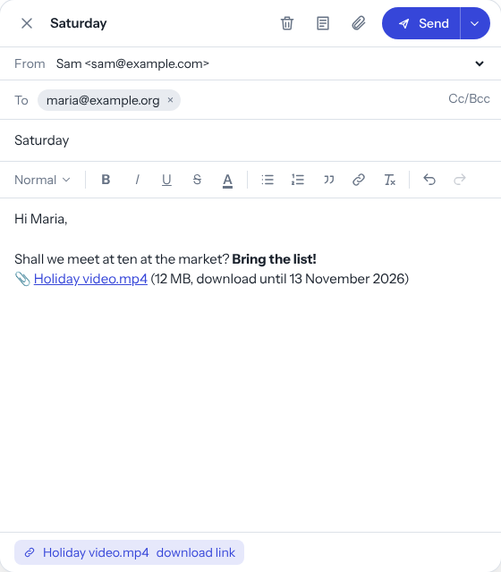

Files over 10 MB, or too large for the mail server, are sent by Postvak as a **download link**:

1. Add the file like a normal attachment. At the bottom you see how far the upload is.
2. When it is done, a link is in your message (above your signature).
3. The recipient clicks the link and gets a page with a **Download** button.

The files are kept on your own Postvak server, not with another service. A link works for **30 days**; after that
the file is removed automatically. Under **Settings → Privacy** you see all your shared files and how often they
were downloaded, and you can copy the link or remove the file earlier. A file can be at most 2 GB.

## 10. Several mail addresses

Under **Settings → Accounts** you add other mail addresses (for example info@ of your company). You still log in
only once.

- **All inboxes** shows the inboxes of all your addresses together; each message has a coloured dot for its
  account. Click an account on the left for the folders of that address.
- Prefer each address separately? Switch off **Show all inboxes together** under Settings → General.
- For each account you choose a name, colour, signature and whether you want notifications for it.

## 11. Rules and out-of-office reply

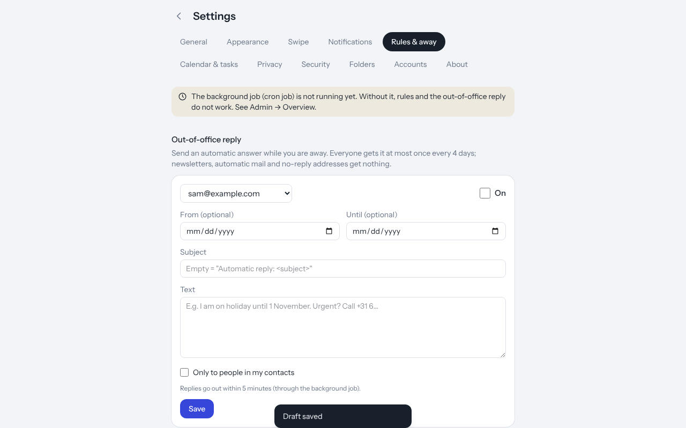

Under **Settings → Rules & away**.

**Rules** sort new mail in your inbox automatically. A rule has one or more conditions (sender, recipient,
subject or anything; contains, does not contain, is, starts with, ends with) and an action: move to a folder,
mark as read, star, give a label or throw away. You can also make a rule from a message: click the funnel next to
the sender.

**Out-of-office reply**: switch it on, optionally choose a start and end date and write your text. Everyone gets
the reply at most once every four days; newsletters, automatic mail and no-reply addresses get nothing. With
**Only to people in my contacts** you limit it further.

> Rules and the out-of-office reply run on the server through the background job (cron job), every few minutes.
> So they also work when Postvak is not open. Do not switch on an automatic reply at your hosting company at the
> same time, or people get two.

## 12. Calendar

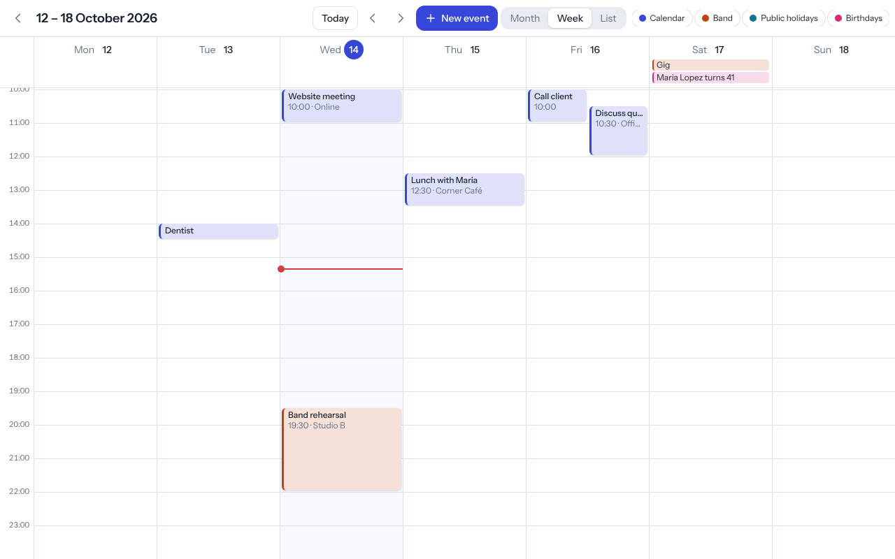

Choose **Calendar** on the left. There is a month, week, day and list view.

- **New event**: click a time or **New event**. You can set a place, description, repetition (e.g. every week)
  and reminder. Reminders arrive as a notification on your phone or computer.
- **Several calendars**: create more under **Settings → Calendar & tasks**, each with its own colour.
- **Birthdays**: your contacts' birthdays appear in the calendar by themselves, as all-day items (with the age
  when the year of birth is known). Click one to open the contact. The **Birthdays** button at the top hides them
  for a moment; switch them off completely under **Settings → Calendar & tasks**.

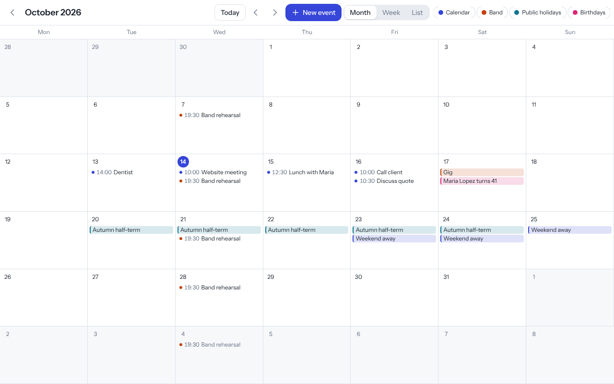
- **Invitations** you get by mail are answered from the message (see [Reading mail](#4-reading-mail)).
- **A calendar from elsewhere** (Google, Outlook, your sports club or public holidays): paste its iCal address
  under Settings → Calendar & tasks → **Add a calendar from elsewhere**. Postvak fetches it every half hour; it is
  read-only. For a Google calendar use the **Secret address in iCal format**; the steps are on that page.
- **See your Postvak calendar in Google or Outlook**: make a **Share link** for the calendar and add it in Google
  under **Other calendars → + → From URL**.

## 13. Tasks

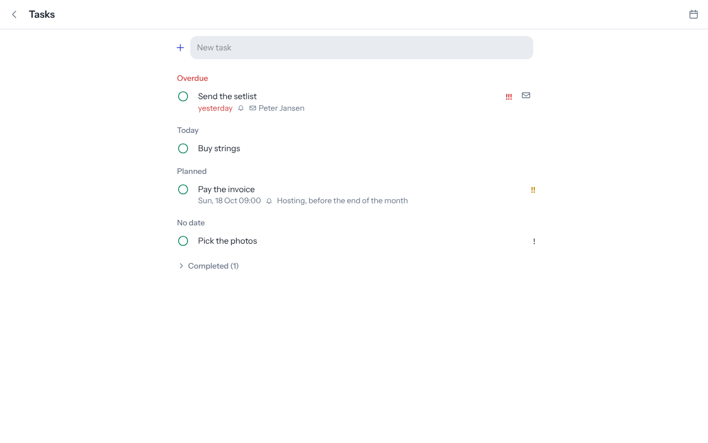

Choose **Tasks** on the left. You can have several task lists, with a due date, priority and reminder per task.
Turn a mail into a task with one click: the check-mark icon at the top of an open message.

## 14. Contacts

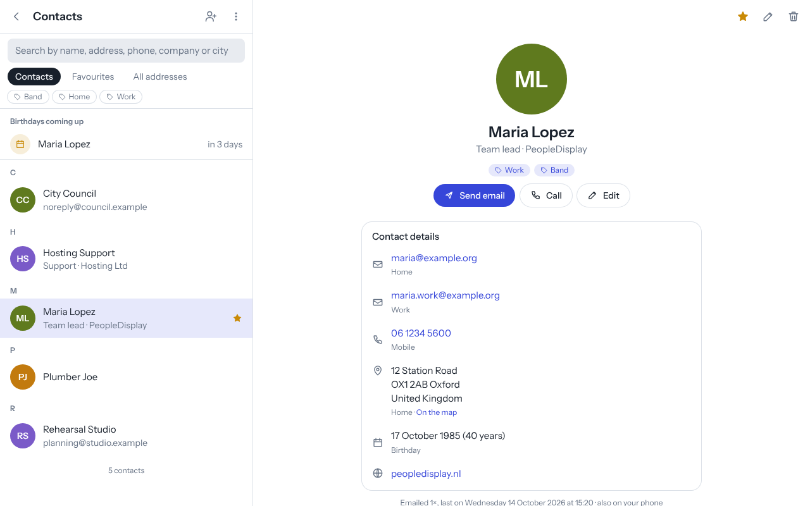

Choose **Contacts** on the left. As in Google Contacts, every contact has its own card with:

- a **photo**, **first and last name**, nickname, **company, job title and department**;
- several **email addresses** and **phone numbers**, each with a type (home, work, mobile, …);
- **addresses** (with a link to the map), a **birthday** (also without a year), **websites** and **notes**;
- **groups**, such as Family, Work or Band. Click a group at the top of the list to see only those contacts.

**Send mail** and **Call** get in touch straight away. Birthdays in the coming week are at the top of the list
under **Birthdays coming up**. Search looks at names, addresses, phone numbers, companies, cities and groups.

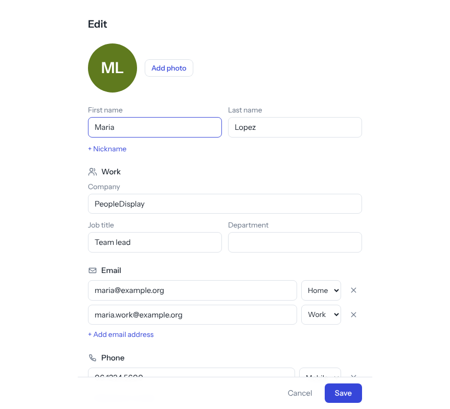

- **Edit**: click **Edit** on the card. **+ Add email address**, **+ Add phone number** and so on add extra
  lines; **Add photo** picks a photo (Postvak makes it square and small).
- **Import and export** with vCard files (.vcf), for example from Google Contacts, Outlook or your phone. Company,
  addresses, birthday and groups come along.
- **All addresses** also shows people Postvak remembered automatically when you mailed them.
- Everything, the photo too, syncs with the contacts app on your phone (see
  [chapter 15](#15-calendar-tasks-and-contacts-on-your-phone)).

## 15. Calendar, tasks and contacts on your phone

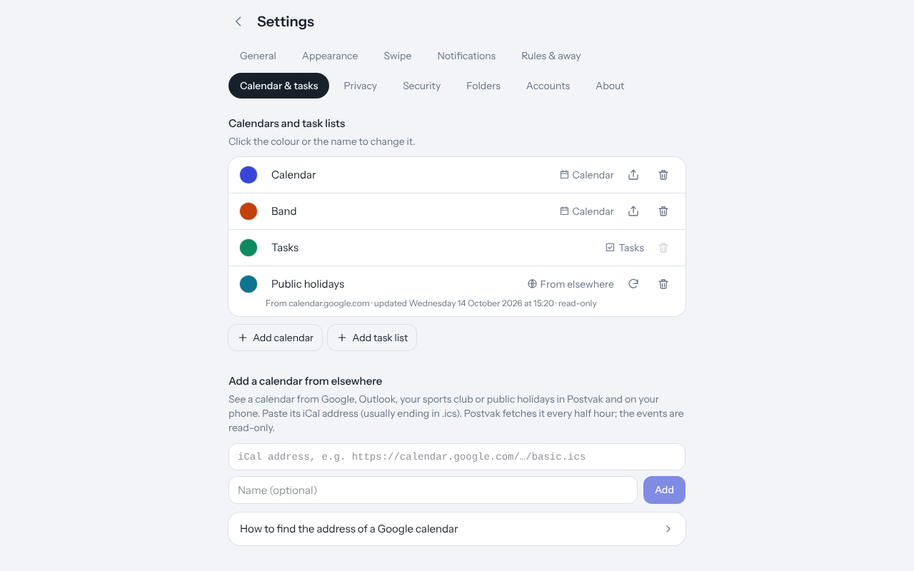

Your calendar, tasks and contacts can also live in the normal apps of your phone or computer. Changes go both
ways. To set it up:

1. Go to **Settings → Calendar & tasks**, section **On your phone or computer**.
2. Create an **app password** for your device (for example "iPhone"). Your mailbox password does not work here:
   this way you can shut out a lost phone on its own with **Revoke**.
3. Copy the password right away: Postvak shows it only once.
4. Follow the steps for your device on that page (**How to set it up**):
   - **iPhone and iPad**: Settings → Apps → Calendar → Calendar Accounts → Add Account → Other →
     Add CalDAV Account. Tasks go to Reminders. For contacts the same with a CardDAV account.
   - **Android**: install the app **DAVx⁵** and log in with URL and user name. For tasks DAVx⁵ works with, for
     example, Tasks.org.
   - **Mac**: System Settings → Internet Accounts → CalDAV account (and CardDAV account).
   - **Thunderbird**: New Calendar → On the Network, and New Address Book → CardDAV.

The server and your user name are on that page, ready to copy.

## 16. Notifications for new mail

Under **Settings → Notifications** you switch on notifications for the device you are using. Do this on every
device where you want them. Use **Test notification** to check that it works.

- On **iPhone and iPad** notifications only work when Postvak is on your home screen (see
  [chapter 2](#2-postvak-as-an-app-on-your-phone-tablet-or-computer)); open it from there.
- With several addresses you choose per address whether you want notifications.
- Told that notifications are blocked? Click the padlock or sliders icon to the left of the address in your
  browser, set **Notifications** to **Allow** and reload the page.

## 17. Settings

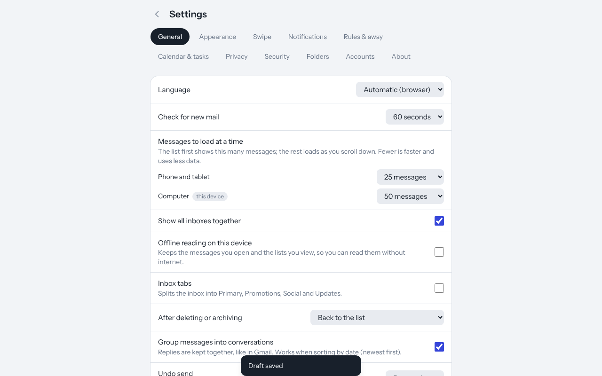

Click **Settings** at the bottom left.

| Tab | What you set here |
| --- | --- |
| **General** | Language, how often Postvak checks for new mail, messages to load at a time (phone/tablet and computer), offline reading, inbox tabs (which ones you see, senders you placed yourself), what happens after deleting or archiving, all inboxes together, conversations, undo send, mark as read when opened, version and updates, log out |
| **Appearance** | Light or dark, accent colour, text size (small to extra large, also for the text of your mail), comfortable or compact, a preview, manage labels |
| **Swipe** | What swiping left and right does, how long Undo stays, confirmation before deleting |
| **Notifications** | Notifications on this device, on or off per account, test notification |
| **Rules & away** | Rules for new mail and the out-of-office reply |
| **Calendar & tasks** | Show birthdays, calendars and task lists, calendars from elsewhere, share links, syncing with your phone |
| **Privacy** | External images, safe senders, large files (download links) |
| **Security** | Two-step verification on or off, recovery codes, remembered devices |
| **Folders** | Create, rename and delete folders |
| **Accounts** | Add mail addresses, name, colour and signatures |
| **About** | Version, who makes Postvak, licence, links and this guide |

Under **Appearance** a **preview** of the message list and a message shows straight away what the settings do:
**Text size** makes all text larger or smaller, the text of your mail included; **Comfortable** shows a picture
circle and a preview line, **Compact** fits more messages on the screen.

  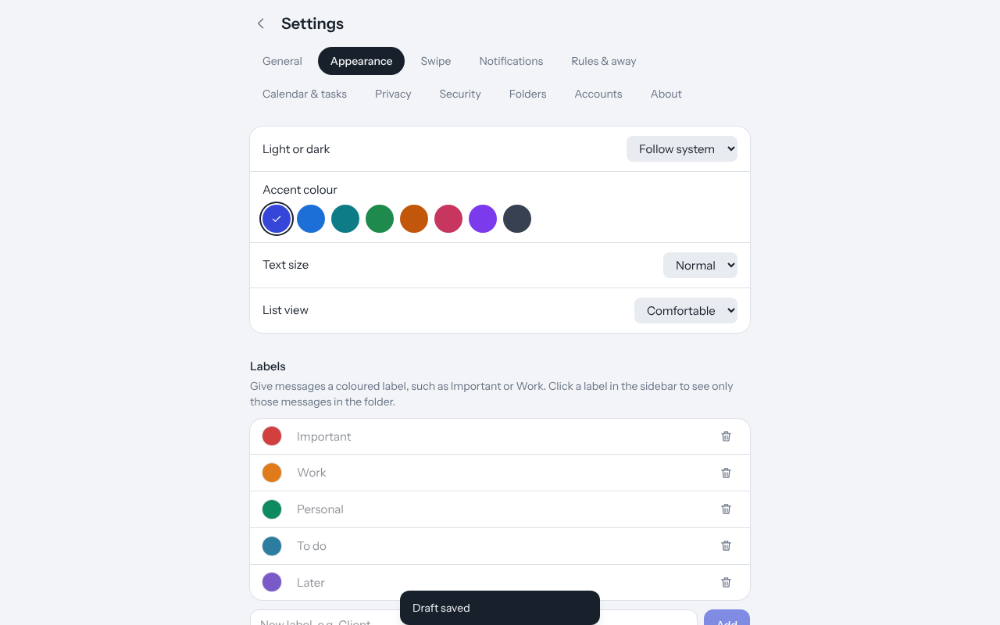
  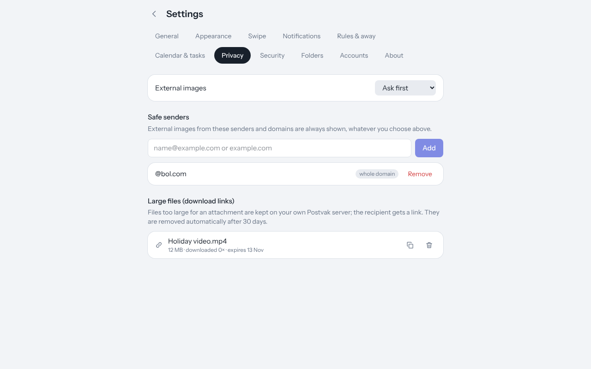

## 18. Keyboard shortcuts

On a computer Postvak also works with the keyboard. Press `?` for this list inside Postvak.

| Key | Does |
| --- | --- |
| `j` / `k` | Next / previous message |
| `Esc` | Close the message |
| `r` | Reply |
| `a` | Reply all |
| `f` | Forward |
| `c` | New message |
| `e` | Archive |
| `#` or `Delete` | Delete |
| `!` | Spam |
| `b` | Snooze |
| `x` | Select |
| `/` | Search |
| `Ctrl + Enter` | Send (in the compose window and in quick reply) |
| `?` | List of shortcuts |

## 19. Privacy and security

- Your mail stays on your own mail server; Postvak keeps no copy of it (only the short preview line for the
  message list). Calendar, tasks and contacts are stored in the database of your own Postvak.
- Mailbox passwords are stored encrypted.
- The HTML of incoming mail is cleaned on the server and again in the browser, and shown in a sealed-off frame,
  so a message cannot do any harm.
- Images from the internet are only loaded when you want them.
- **Two-step verification** (Settings → Security) makes sure your password alone is not enough to log in. Keep
  your recovery codes in a safe place.
- Nothing goes to PeopleDisplay, advertisers or anyone else. Notifications travel encrypted through your
  browser's push service (Apple, Google or Mozilla).

## 20. For the administrator

The first user to log in is the administrator, unless the administrators are set in `config.php`
(`'admins' => ['you@example.com']`). Administrators see **Admin** on the left:

- **Overview**: version, database, background job (cron job) and any errors during an update.
- **Users**: who uses Postvak, and switching off two-step verification for someone who lost their phone.
- **Security**: failed login attempts and lifting blocks.
- **Settings**: which mail domains may log in, whether users may enter their own server, and the **default
  settings** for new users (swipe, theme, messages to load at a time and more).

The **cron job** is needed for notifications, rules, out-of-office replies, send later, snooze, reminders,
calendars from elsewhere and cleaning up expired download links. How to set it up is in
[INSTALL.md](INSTALL.md) and under Admin → Overview. Installing updates and updating the database happen by
themselves; see also the [list of changes](../CHANGELOG.md).

## 21. Questions and problems

**My phone does not show the newest version.**
Open Postvak again or choose **Settings → General → Check for updates**. If the **Update** bar appears at the
bottom, tap it. If you have a version from before 1.6.1, close the app completely once (and any browser tabs with
Postvak) and open it again.

**I get no notifications.**
Check under Settings → Notifications that they are on for *this* device and send a test notification. On
iPhone/iPad Postvak must be on the home screen. If the test works but new mail brings no notification, ask your
administrator whether the cron job is running.

**My rule or out-of-office reply does nothing.**
They are run every few minutes by the cron job. The rules show how often each rule was applied; if there is a
warning about the background job, tell your administrator.

**My mailbox is (nearly) full.**
Check at the bottom left how much space you use. Empty the trash and spam, and look under **Attachments** for large
files you no longer need. Need more space? Your administrator or hosting provider arranges that.

**A message is in the wrong inbox tab.**
Choose **⋮ → Move to another tab** on the message (or right-click it in the list). New mail from that sender will
then go to the right tab by itself.

**A newsletter keeps coming after unsubscribing.**
Some senders take a few days to process it. If it keeps coming, choose **⋮ → Block sender**.

**An attachment is too large.**
Above 10 MB Postvak turns it into a download link by itself (see [chapter 9](#9-sending-large-files)).

**My calendar does not show on my phone.**
Check that you use the app password (not your mail password) and that you copied the server exactly as shown on
Settings → Calendar & tasks.

**I lost the phone with my authenticator app.**
Log in with one of your recovery codes, or ask the administrator to switch off two-step verification for you.

**Report a problem or share an idea?**
On [GitHub](https://github.com/peopledisplaynl-coder/postvak/issues), or via the link under **Settings → About**.

---

Postvak is made by [PeopleDisplay](https://peopledisplay.nl) and is open source (MIT licence).
The screenshots come from the demo with sample data; make them again with `node scripts/manual-screenshots.mjs`.
